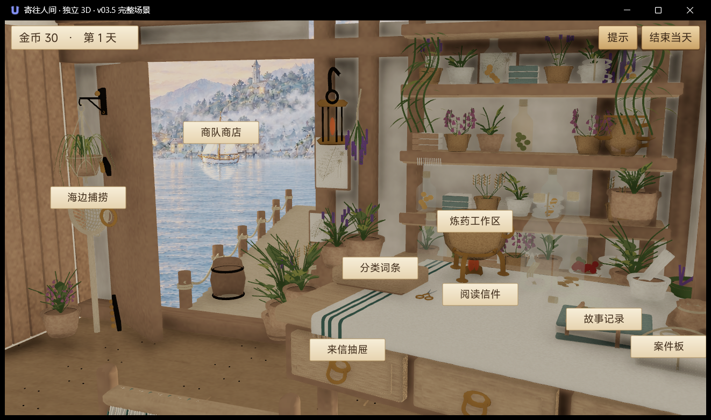

> 历史记录（清理前基线）：下文保留当时的实现、验收与限制；旧路径、旧工具命令、旧压缩包位置不再是当前操作步骤。当前启动与维护使用 [操作手册](RUNBOOK.md)；被清理文件可在提交 `7460d04e697c5ca7e6d312afae3cb0ef769ecc4b` 中查阅。

# v035 完整场景实际运行验证

更新时间：2026-10-13，UTC+8。工作仅限 `D:\taptap\To-the-Human-World-3D-Lab`；正式 2D 未改动，未提交、推送或操作其他代理。

## 当前结论

完整场景已实际显示并交互，attempt 06 的八项程序事件入口全部通过；PID 56268 保持运行。用户已暂时暂停人工测试，自动鼠标操作已停止。人工完整验收尚未完成，不能把程序事件通过写成真实点击全通过。

## 已完成修复

1. `FullSceneHost` 的 epoch 计时绑定在 Start 第一行报错，改用运行库 UI 已使用的实例单调计时接口，实际完成全量载入。
2. RH 相机原生射线正确，但 `WorldToScreenPoint` 错误夹到 0/1。改用实际 view/projection 矩阵的有符号齐次 W；仍保留八点投影和原生射线校准，旧接口结果也保留在诊断。
3. 完整包的 V 坐标翻转后，窗景及商船上下方向恢复；原始 PNG 和网格字节不变。
4. 案件绑绳在共享静态网格中，挡住中心拾取射线。仅在实际纸堆包围范围加 3.5 cm 内把该绑绳识别为附件，其他共享网格区域、其他物件仍能遮挡。
5. 观察器保存带同步权限的精确进程句柄；截图使用正确的 Windows DPI 坐标。官方持久预览及单实例启动入口已准备。

## 资源和业务边界

90 网格、3,209,455 三角面、10,790 源物件、862 原生几何批次，家具植物均保留。150 运行资源（含 26 张法线贴图）逐文件源哈希和官方 prepare 产物匹配；另有运行资源哈希索引。固定 main `1cd0cdbec06487a5c60f109d5fd477198cfc8846` 的 80 个业务模块保持原样。

海边与炼药没有交付独立 3D 相机时，进入原业务页面；进入海边不自动捕捞，进入炼药不自动试做。单一 GameSession/PlayModel，`d3_lab_v035` 纯内存存储，不写正式存档。没有独立剪刀主页入口。

## 已确认的运行记录

| 轮次 | PID | 实际结果 | 退出 |
|---|---:|---|---|
| 旧 attempt 02 | 13764 | prepare 成功，日志停在公共包下载，未证明进入场景 | 缺少退出码，原因未知 |
| 本轮 attempt 03 | 51764 | 引擎加载成功，Start 计时 API 错误，实际黑屏已保存 | 官方主动结束；Runtime 1，CLI 1 |
| attempt 04 | 46088 | 全量载入 203.536 秒；相机校准失败，纹理倒置，实际整屋已显示 | 修复前官方主动结束；Runtime 1，CLI 1 |
| attempt 05 | 30960 | 全量载入 196.457 秒；相机通过，实际全屋和正向窗景；7/8 程序入口 | 官方 600 秒时限到期；Runtime 1，CLI 1 |
| attempt 06 | 56268 | 官方持久预览；90 网格/862 批次、相机、8/8 程序入口通过，整屋实际画面已查看；场景加载 114.005 秒 | 持续运行，尚未退出，不填 0 |

attempt 05 相机 pointError=1.4067163e-13，rayError=3.1770418e-14。峰值工作集 1,766,084,608 B（1684.27 MiB），采样私有内存峰值 2,775,257,088 B（2646.69 MiB）。场景加载耗时不包含官方 prepare 和引擎网络下载；Update 帧时间不等于 GPU profiler 数据。

attempt 06 session=`46ffe50f-e458-49ab-8cff-855a9dcac2c0`；Runtime 创建时间 2026-10-13 23:13:23.938 UTC+8。截至交给人工测试，峰值工作集 1,786,318,848 B（1703.57 MiB），采样私有内存峰值 2,819,645,440 B（2689.02 MiB）。日志位于该 session 的 `0/runtime.log`，证据目录中的 `runtime-summary.json` 记录绝对路径。游戏仍运行，观察器会在真正退出后记录退出码。

## 验证分层

- 离线：真实固定业务、内存隔离、生成包、投影夹边、绑绳命中边界回归通过；详见 `evidence/v035-main-interface/offline-v035.json` 和 `full-staged-check.json`。
- 程序事件：attempt 06 直接调用实际 UI callback，并走原生射线/拾取；8/8 打开正确页面。遍历前后业务快照和内存写次数不变。
- 系统鼠标：attempt 05 已实际点击抽屉、绿色本子、托盘、捞网并查看正确页面；关闭前三个面板成功。进入海边仍显示开始捕捞、剩余 1 次。attempt 06 另确认案件页面，以及在验证鼠标点归属后关闭案件、打开商队商店。其余项目、真实购买和重复打开交用户人工测试。
- 画面：实际全屋截图为 `evidence/3d-lab-r3/native/full-05-dpi-correct/0000-20261013T150302894Z.png`；海边实际截图为 `evidence/3d-lab-r3/native/os05-seaside/0000-20261013T150618693Z.png`。此前 1058×625 的截图因截图程序 DPI 错误裁切，不能代表完整构图；修复后窗口 PNG 为 1322×781，游戏客户区 1304×734。

## 剩余问题

人工待验：八入口完整鼠标回归、提示开关、海边/炼药返回、重复打开、阅读剪词购买试做及结束当天。此前桌面悬浮键盘遮挡造成点击与旧 PrintWindow 截图不一致；受遮挡的点击不算通过。工具现先验证前台、非最小化、光标位置和 WindowFromPoint 所属，临时抬高的也仅是 Lab 自己的窗口。最新购买尝试因未取得前台而在发送鼠标前中止。用户主动接手、随后暂停测试，已停止自动输入，不操控外部悬浮程序。引擎发行包仍报告 `Cube/Day/DaySpecularHDR.dds` 与 `themis_x64.dll` 缺失；已显示的场景不因此崩溃，但不宣称日志零错误。实际光照、玻璃、法线外观与 Blender 参考没有做像素等价验收，手机及触屏性能未验证。

## 启动

双击 Lab 根目录 `Start-3D.cmd`，或运行 `Start-3D.ps1`。启动入口先检查本 Lab 状态；已运行时只显示现有 PID，未运行时使用官方 prepare 和支持外部 Runtime 的持久 preview supervisor。不会提交、推送、改绑或自动重启失败进程。首次进入要等待公共资源网络下载；本轮场景本身加载 114 秒，前两轮约 3 分钟。普通入口已关闭自动八入口观察巡回，不影响目前已完成巡回的运行实例。每次使用新的证据编号保存日志，游戏保持运行直到关闭；存档是本次进程内的隔离会话。

完整行动记录：`actions/2026-10-13-v035-main-interface.md`。每轮准确 session/PID、原始 CLI、进程指标、退出码与摘要位于 `evidence/v035-main-interface/native-full-20261013-NN/`。

## 当前完整场景截图

已确认的前台真实商店画面：`evidence/3d-lab-r3/native/os06-verified-shop/0000-20261013T154005822Z.png`。购买前显示金币 30、海盐已有 3 份。
