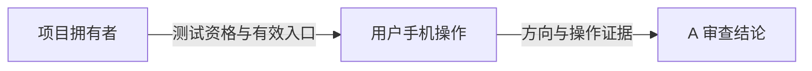

# 手机屏幕方向实测

## 状态与情况

- 状态：Blocked（用户手机提示无测试资格，新增二维码与添加白名单均被当前协作者权限拒绝）；需项目拥有者处理测试资格，游戏方向尚未验收。
- 任务：A-DEVICE-20261010，r3。用户随后暂时改定横屏，r3 将后续方向验收目标改为横屏，替代 r2 的沿用原竖屏目标；r2 的资格失败与工具拒绝记录保持。用户已明确提供手机 TapTap 用户 ID `797588145`，此前停止的桌面窗口不因此重启。新设计任务见[横屏主页提示词](../设计/B窗口_横屏主页整图提示词_v01.md)。
- 上游：[方向核查 A-ORIENT-20261010 r1](../验证/2026-10-10-maker-screen-orientation.md)。用户统筹，A 核查入口和证据，用户操作手机；不主动联系其他窗口。
- 本机：`D:/taptap/To-the-Human-World`，HEAD `5c39738334635fe8f7ccb8d6fb52597ff66f98ac`。工作区已有未提交的前端修复、素材及文档，全部保留；不自动提交这些修改。
- 活动 Maker：0.0.36，当前项目 m_h4x3、App 955210，本地发布配置 `landscape`。调用前 project.json SHA-256：`faa52457afa1f643c06890682f578c5aa925cf87be0e5d34bf77437089e85781`。
- 范围：获取现有应用测试二维码，核对手机冷启动与旋转后的屏幕方向。能进入后可记录界面/触控现象，但不将远端版本当成本机未提交修复的验收。
- 排除：不改方向字段、不新建或换绑、不调用独立远端提交构建或正式发布、不操控桌面鼠标。二维码工具自身可能构建/上传远端测试版本，按当前工具流程执行；未知执行结果不盲目重试。

## 实施措施

1. 核对项目状态、身份、方向及本地工作区；已完成。
2. 对同一 target_dir 调用官方 `generate_test_qrcode`，不传已存在的方向参数。保存工具给出的测试入口、时间及可用的版本信息；没有提交哈希则明确记录无法对应代码版本。
3. 向用户展示二维码；先验证竖着拿手机进入时的方向，再验证旋转与重新进入。记录手机型号/系统、TapTap 版本、入口及时间；结果未知时保持待验。
4. 根据手机反馈、截图或必要的官方只读反馈日志作结论。截图只证明当时显示；交互、冷启动及恢复分别需要操作证据。
5. 新截图明确提示“当前账号没有测试资格”。先将用户明确提供的 `797588145` 传给官方 `add_test_whitelist`，target_dir 沿用当前项目；记录实际返回，不推断账号、不混用 App ID，也不绕过权限。成功后再请用户用同一账号复测。

## 影响文件树

```text
docs/actions/2026-10-10-mobile-orientation-test.md  新增：本轮入口、手机证据与交接记录
docs/验证/2026-10-10-maker-screen-orientation.md   追加后续实测状态入口
docs/验证/evidence/2026-10-10-mobile-test-eligibility.jpg  用户原始资格拒绝截图的证据副本
.project/project.json                           只读核对，调用后哈希不变
```

不修改游戏实现、素材或编辑器项目。既有方向研究和 10 月 9 日验收记录保留原日期与结论。

## 自检方法

- `maker_status_lite(target_dir=...)`；核对 HEAD、工作区与本地方向，不输出凭证。
- 检查二维码工具返回的成功/失败状态及实际入口，不把二维码图片当作运行通过。
- 调用前后对比 HEAD、项目身份与配置哈希，记录工具引起的实际变化。
- 手机先验收方向：竖持进入、旋转设备、退出游戏再进入；分别记录方向及是否锁屏。屏幕旋转锁状态需要用户提供，不猜测。
- 本轮记录的相对链接与 `git diff --check`。

## 自检结果

- 项目状态 ready；Maker 0.0.36，绑定/健康/认证就绪。
- 本机 HEAD 和本地方向已核对；前端修改未提交，不承诺测试入口包含这些修改。
- 2026-10-10 13:03（UTC+8）前后，对同一 target_dir 调用 `generate_test_qrcode`，未传方向参数。未取得新二维码；返回 `RemoteProxyToolCallError`、`remote_proxy_tool_call_error`、MCP `-32600`，明确消息为 `Tool is not allowed for collaborators`。当前身份不允许此操作；此业务权限拒绝不是引擎横竖屏能力证据。
- 工具同时标注 `executionState=unknown`、`automaticRetry=false`。没有重复调用，也未声称远端绝对没有发生任何操作；当前没有可识别的新测试入口或版本。
- 调用后本机 HEAD、App 955210、project_id m_h4x3、landscape 及 project.json 哈希均不变；没有调用独立提交/构建/发布工具。
- 旧入口沿用[10 月 9 日已生成的二维码](https://tapcode-sce.spark.xd.com/qrcode/m_h4x3_1791552699487.png)。本轮网页工具返回“URL is not accessible via this tool”，所以只提供历史链接供手机尝试，未确认图片当前可访问、二维码有效期或手机版本。工具读取失败不能证明二维码过期。
- r1 时手机运行：Pending；当时没有手机截图。后续 r2 已取得平台错误页截图，仍未取得游戏内画面、旋转操作或冷启动反馈；旧二维码和本机静态配置不计作实测通过。
- 文档链接及差异检查：本记录与方向核查报告的本地链接全部存在；`git -c core.safecrlf=false diff --check` 退出码 0。

### r2：手机测试资格拒绝

- 用户回传截图：`C:/WINDOWS/TEMP/codex-clipboard-c79d9304-7a83-434d-9609-4b0ed9a085bb.jpg`，SHA-256 `9086261f0a209b173b8e5822b9238756819b77a1ab153f6d41c1086107ab5653`；保存为[原图证据副本](../验证/evidence/2026-10-10-mobile-test-eligibility.jpg)。
- 目视内容：加载失败页，显示“游戏加载失败，点击重试”，底部提示“当前账号没有测试资格”。这证明本次入口的资格检查未通过；未见游戏画面。错误页为竖向不能证明游戏支持竖屏，截图也不提供所载游戏的版本或可独立核验的 App ID。
- 当前白名单成员及手机登录账号尚未从平台独立查询；用户随后明确提供 `797588145`，不从截图或其他账户记录推断 ID。
- 已核对当前 Maker 0.0.36 的 `add_test_whitelist` 契约：仅接受用户明确给出的 TapTap user_id，项目须已初始化且有二维码建立的应用身份。本项目已有 App 955210；调用前 `maker_status_lite` 再确认初始化与健康 ready。
- 实际调用 `add_test_whitelist(target_dir="D:/taptap/To-the-Human-World", user_id=797588145)`，返回 `RemoteProxyToolCallError` / `remote_proxy_tool_call_error` / MCP `-32600`，明确消息 `Tool is not allowed for collaborators`。未取得添加成功或成员已存在的确认；工具同时报告 `executionState=unknown`、`automaticRetry=false`，未重复调用。
- 手机方向、触控与恢复仍未验收。当前已有明确的平台资格失败信号，不在游戏代码中猜改或增加日志；恢复资格后用同一账号重新进入才是下一次有效验证。

## 交接对象与汇报内容

- 本次交给：用户（统筹），由用户转交项目拥有者；未主动发送。
- 任务编号/依据/成果：A-DEVICE-20261010 r3；技术核查 r1、方向口径 r2；成果为本记录及用户资格拒绝截图副本，r3 仅同步验收目标，没有新增运行结果。
- 审查结论：测试资格检查不通过，且本机无权开通；手机游戏方向证据不足，不能由竖向错误页判定支持竖屏。
- 必须处理项：项目拥有者核对当前手机账号 `797588145` 的测试资格，添加到 App `955210` 白名单并回传成功确认；尚无已证实的游戏代码修改项。
- 可选建议：资格恢复前不反复刷新或重跑整套玩法。
- 下一步：拥有者处理白名单并确认有效测试入口与版本后，用户用同一账号扫码，记录实际游戏画面和旋转表现；A 再审查方向。
- 需要用户决定的事项：无；用户已决定暂时改为横屏，当前先出主页总体图。测试资格与正式手机验收仍待处理。

可转发给拥有者：

> 请将 TapTap 用户 `797588145` 加入《寄往人间》App `955210`（项目 `m_h4x3`）的测试白名单，并回传添加结果及可用的测试二维码/版本。手机提示“当前账号没有测试资格”；本机调用 `add_test_whitelist` 和 `generate_test_qrcode` 均被拒绝：`Tool is not allowed for collaborators`。这轮先测手机方向，沿用现有绑定，不改方向字段或新建应用；请注明测试版是否包含最新前端修改。


