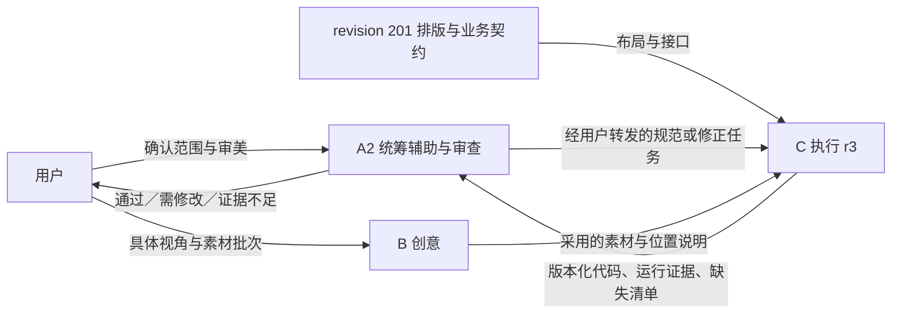

# 《寄往人间》A2 统筹辅助与独立审查交接

> 交接任务：A-HANDOFF-20261010 r1。日期：2026-10-10（Asia/Singapore，UTC+8）。
> 接收者：用户新开的第二个统筹／审查窗口 A2。由用户转发，不自动创建会话或发送消息。
> 用途：无需重读旧聊天即可接续当前主页接入工作。它是带时间边界的事实交接，不是“全部功能完成”的报告。

## 1. 先知道现在在做什么

项目根目录：`D:\taptap\To-the-Human-World`。

当前目标是把用户在网页排版编辑器中完成的横版主页，接入现有 Maker / UrhoX Lua 游戏。网页编辑器是排版工具，最终游戏是另一个运行环境；JSON／PNG 导出不会自动生成游戏按钮、接口和存档行为。

**C 已在执行 `C-HOME-ENTRY-20261010 r3`，不要重复派工、重建一套前端或用旧聊天判断 C 尚未开始。** 本次约 21:41 的文件现场已有 landscape 组件、运行素材和 PlayView 装配改动。C 的[行动与验收记录](../../scripts/actions/2026-10-10-home-entry-r3.md)仍为“实施中”，自检结果为 Pending。A 此轮仅核对存在性、记录和版本，没有独立审查或运行这批新代码。

这里最容易继承错的三条旧结论已经撤回：

1. **不补日历图片。** 用户最新明确取消日历，不能再将“缺日历”列为美术不通过。
2. **信纸必须是读信入口。** “是否新增读信功能需要决定”是 A 之前的误判，已经纠正。
3. **landscape 目录已经出现，C 正在实施。** 较早“目录不存在、PlayView 仍为旧界面”的观察已过时。

## 2. 角色、授权和工作方式

- 用户：负责统筹，决定审美、产品取舍和新增范围。
- A／A2：统筹辅助、需求拆分、规范、独立审查和可转发的交接。优先检查文件、预览和操作证据，尽量不亲自修改正在被审查的代码或素材。
- B：创意与素材制作；新 B 的上下文应以最新主页和本轮需求为准。
- C：排版编辑器、前端和素材接入执行；当前主改 `scripts/ui/landscape/`、`scripts/ui/PlayView.lua` 及采用的运行资源。
- 程序侧：主改 PlayModel、main、core、systems、data。接口不足由 C 提出具体依赖，不绕开业务校验。
- E 不自动启用；不要因为旧文档写“E 接入”就创建新分工。

窗口间由用户转发。没有其他窗口完整聊天，不假装能看到；不主动新建或联系窗口。A2 可以维护职责内任务／审查记录，遵守 action-document，但不能凭交接扩大到实现、发布、推送或整套新美术。

用户偏好：先通俗回答问题，再给一份完整可复制的提示词；避免同时给多个容易混淆的版本；已确认事项不要反复索取确认。每轮展示简洁 DAG，边上说明传递信息。

## 3. 读取顺序与证据优先级

1. 根目录适用的 [AGENTS.md](../../AGENTS.md)；完整读取 `C:\Users\YINGYI\.codex\skills\project-control-report\SKILL.md`。文件修改前读取 action-document。
2. 本 handoff 与 [C 的 r3 行动记录](../../scripts/actions/2026-10-10-home-entry-r3.md)，核对现在是否又有更新。
3. [横版前端计划](../superpowers/plans/2026-10-10-landscape-frontend.md)、[程序计划第 3 节](../superpowers/plans/2026-10-10-landscape-program.md)、[接口手册顶部 2026-10-10 增量](../../scripts/前端接入接口手册.md)。
4. 当前排版工程、采用的实际素材、C 实现与证据；需要追溯时再读旧草案。

需求以用户最新明确决定优先；用户决定、方案默认值和 B／A 的建议分开记录。当前代码／实际测试用于判断“实现了没有”，不因为已有代码改变用户要求。

已知文档冲突：前端计划仍可能写日历入口、漏列信纸、写新增接口尚未实现。日历和信纸按 r3 与本交接执行；接口实现状态按手册顶部和代码核对。旧 v0.1 手册正文是历史基线，不能盖过顶部 schema 3 增量。旧竖屏草案只用于未被替代的功能追溯，不恢复旧竖版构图或已取消动画。

C 的 r3 已负责对前端计划作最小同步。A2 启动先核对同步是否完成，不抢写 C 正在编辑的文件，不为整理交接而改全局技能或协作总指南。

## 4. 当前工程、资源与核查版本

| 项目 | 核查结果与用途 |
| --- | --- |
| 本地代码 HEAD | `e4d28622e31838c6d48a564e5ae829bf0dc5de18`；仅是提交基线，工作区有 C 新实现及其他并行改动 |
| 用户原始排版工程 | `C:\Users\YINGYI\Downloads\寄往人间-排版项目-v0.1-2026-10-10\project.json` 及同目录 assets |
| 项目内排版副本 | [scripts/主页排版工程文件/project.json](../../scripts/主页排版工程文件/project.json)；本轮核对 JSON 与下载目录哈希相同，便于新窗口定位 |
| JSON SHA-256 | `e4ccb82e4c8b64c0abb8a3c1a005d04b82aa7b0123ec89eec58c1996a50c8ce6` |
| 格式与版本 | `to-human-world-layout`，schemaVersion 1，appVersion 0.1.0；project revision 201，主页 revision 189 |
| 主页 | 1 页，1920×1080，11 个可见图层；资产库 39 份，不是都要打进运行包 |
| 早期选图 | [室内药铺、开门与码头参考](../设计/原型/home-indoor-dock-threshold-v01.png)，1672×941；当前接入位置与素材选择以 revision 201 排版为准，不回退到这张旧整图 |
| 应用身份 | 本地 `.project/project.json` 为 App `955210`、project `m_h4x3`、`landscape`；本轮未查远端、未重新构建 |

排版坐标：左上角原点；x/y 是图层中心；width/height 包含透明余量；rotation 是顺时针角度；layers 数组从底到顶。编辑器锁定状态不是游戏禁用状态。

39 份下载素材在前一轮已逐份检查文件、声明尺寸和 SHA-256，无异常；本次又核对了项目内副本引用的全部 39 份素材，文件存在、尺寸和哈希均相符。主页使用的物件图片有真实透明通道，但仍有不同程度的外围透明余量。**透明通道通过不等于边缘、热区、所有比例或手机交互通过。**

当前背景保留了记录书、抽屉、打开的漂流瓶、钱袋等；主页独立图层包括船、网、托盘组合、信纸、档案袋、炉子及数个装饰瓶。不要因书和抽屉不独立分层就认定缺入口。

## 5. 用户决定与实施默认值

### 已明确的方向／约束

- 横版、手绘室内海边药铺；左侧开门、低木门槛直连码头，右侧工作桌；以当前导出排版为接入基准。旧窗户、竖版四瓶构图不再约束这批工作。
- 桌上信纸有连续、像书信但不可辨读的装饰笔迹；正式阅读正文由程序提供。
- 桌上已有打开的漂流瓶；这不授权恢复拔塞、抽卷纸等旧复杂动画。
- 用户取消日历图片，不补图、不硬塞回原位置。
- 信纸点击打开对应信件详情，包含阅读与委托要求；这是原有功能，不是新增范围。
- 抽屉不做本体拉开的连续动效。用户希望点击后自然推近，再切到正对桌面、抽屉已打开的页面；该新视角仍需后续美术。
- 物件抠图希望按自身范围紧裁，方便排版。现有工程已人工摆好，不为补裁切而直接替换源图、破坏坐标；当前热区单独定义即可。
- 返回桌前保留投料，关闭阅读不自动接单、发货或重置。先看后续和星级，再选择重新熬制或发货。
- 不修改定稿正文、词值、评分、经济配置；不以样例冒充真实收信、购买、案件解锁。

### r3 采用、但不是最终视觉定稿的默认方案

- 以顶部小字“第 N 天”及“结束当天”文字按钮承接原日历功能，确认后调用 NextDay；真实金币也在顶部。
- 第一阶段将完整 16:9 画布等比放入安全区域（contain），余边用协调底色，不裁切、不拉伸。不同比例的更精细重排以后凭证据讨论。
- 信纸绑定优先复用已有选中信件，其次当前订单所属信件；无明确关联则选择真实已收信件，没有信则显示空态，不虚构详情。
- 抽屉先接真实列表，待新视角素材交付后再完善推近与页面外观；阅读、商店等可先由程序组件完成，不等每个面板都生一张整图。

这些默认值已写入给 C 的 r3 任务；不要冒称用户逐项批准了最终位置、字体或所有空态选择，也不要因其是可调整默认值而无理由停工重复询问。

## 6. 当前八个物件入口与接口

| 物件 | 目标与真实接口 | 必须保持的边界 |
| --- | --- | --- |
| 船 | 商店；`GetShopView`、`model.Buy` | 点船只开店，购买需显式操作，关闭回原场景 |
| 捞网 | 海边；`GetSalvageView`、已有 Receive 命令 | 点击只导航，开始捕捞才收信；无候选不造瓶、不提前扣次数 |
| 托盘 | 左侧词条栏；`GetWordTray` | 具体 tokenId／来源不丢；剪刀和干花不成为另一个业务入口 |
| 信纸 | 信件详情；`model.Read`、`letters.GetView`、内容定义 | 展示标题、寄信人、自介、正文、寄信地址、委托要求与报酬；剪词用 spanId；关闭不结算 |
| 炉子 | 炼药工作区；`GetOrderSummary`、`GetDraft` | 打开不熬制、不发货；草稿由业务保存，返回不清空 |
| 黄色档案袋 | 案件板；`GetCaseBoard` | 当前正式实现是 unopened 空态，不伪造线索 |
| 记录书 | 右侧故事记录；`GetJournalStories/GetJournalPage/GetAttempt` | 已重置试做仍保留，历史只读，不泄露未发现故事 |
| 抽屉把手 | 已收来信列表；`GetLetters` | 选择后与信纸共用阅读组件，不能恢复已剪词 |

另有顶部金币、天数、结束当天、各面板关闭／返回；它们不增加新的常驻美术物件。八个物件数已不包含取消的日历。

信纸要求依据：旧[前端草案](../设计/寄往人间_前端界面设计草案_移动端竖版更新.md)明确“阅读信件＝工作台中央信纸”，[主页 v02](../设计/主页原型与分层说明_v02.md)明确“中央信纸→放大读信页”。最新前端计划保留 ReaderModal 和 F2 读信剪词，主页热区表漏列不等于功能被撤销。不要沿用 A 早先错误的“信纸只是装饰／待定”判断。

## 7. 热区与适配：C r3 的审查重点

**透明图片范围不等于点击范围。** 不能把整张 PNG 的矩形直接当按钮，也不需要强迫用户重做排版。

- 在 LayoutManifest 分别记录稳定物件 ID、视觉变换和局部热区；装饰不拦截输入。复杂形状按实际引擎支持采用矩形、椭圆或组合区域。
- 热区跟随同一布局变换，旋转、缩放、安全区变化后不漂移；船和把手可适当扩大，避免重叠。捞网网眼内部也应可点，不要求精准点击细网线。
- 阴影、水波和大块透明空白不作为主体点击范围。单击只触发一个入口。
- 模态阻止穿透，侧面板只挡自身区域；全屏装饰／布局容器不能吞掉锅口或其他入口。
- 开发模式显示热区、ID、命中结果供核查，正常玩家入口不显示调试信息。

用户的 1920×1080 横版设置是正确的；横屏设备不全是 16:9。裁切问题只发生在采用铺满裁切时，**不是工程本身已损坏或必然必须裁切**。本会话实际查看的模拟显示：19.5:9 居中裁切切掉档案袋下部；4:3 居中裁切移除捞网并切掉右侧物件。因此 r3 改用完整等比适配，触控尺寸仍要在最终屏幕检查。

## 8. C 当前任务范围、文件归属与实际进展

有效任务：**C-HOME-ENTRY-20261010 r3，完整替代此前 r1/r2 口径。** 不恢复补日历任务；不漏信纸；不扩展为自动交付整套 F1–F6。

阶段 1：还原主页、八个物件热区和按下反馈、真实金币与天数、导航／关闭／返回路径。未完成目标页明确为开发占位，不假装业务成功。

阶段 2：优先实现已有接口支持的来信列表、阅读剪词、词条栏、商店、记录页和跨天确认；案件板真实空态。海边／炼药可先验证功能界面，正式近景、拖拽与完整演出按后续阶段验收。

| 归属 | 路径与责任 |
| --- | --- |
| C 实现 | `scripts/ui/landscape/` 与 `scripts/ui/PlayView.lua`，保持现有生命周期与同一会话 |
| C 运行资源 | `assets/image/home-entry-r3/`，只采用主页使用的 11 份 PNG；运行引用从 `image/` 开始 |
| C 过程／验收记录 | [scripts/actions/2026-10-10-home-entry-r3.md](../../scripts/actions/2026-10-10-home-entry-r3.md) |
| C 最小文档同步 | 前端计划中的日历、信纸、r3 适配口径；不自行改程序业务契约 |
| 程序侧主改 | PlayModel、main、core、systems、data；接口缺失记录依赖 |
| B 后续美术 | 海边捕捞视图、同一药炉的炼药近景、正对桌面且抽屉已打开的新页面；由用户转交具体批次 |

本次核查期间已经看到 `AppView.lua`、`HomeView.lua`、`LayoutGeometry.lua`、`LayoutManifest.lua`、`Panels.lua`、`tests/import_layout.py`；PlayView 已改为 AppView 装配，运行目录已有 11 份 PNG 和 source-manifest.json。**这是持续变化中的文件存在性观察，不是实现正确性或完工证明；A2 应重新取版本和差异后再审查。**

本轮未访问其他窗口聊天；C 进度依据其行动记录和实际文件。记录中的“预览 stopped”是 C 查询结果的转述，本轮 A 没有重新查询 Maker 状态或启动预览。

## 9. 已有证据与验证边界

以下为本会话上一轮通过编辑器实际 `drawArtwork` 函数，在隔离浏览器中重放并实际查看的图片。本轮仅将原字节副本归档，不导入正在使用的编辑器，不改用户布局。

- [revision 201 主页重放](../验证/evidence/2026-10-10-a2-handoff/home-1920x1080.png)
- [19.5:9 居中裁切模拟](../验证/evidence/2026-10-10-a2-handoff/crop-19_5x9.png)
- [4:3 居中裁切模拟](../验证/evidence/2026-10-10-a2-handoff/crop-4x3.png)

能够支持：导出布局可读取、引用素材存在、按编辑器变换重放的视觉、某种裁切策略的风险。

不能支持：Maker 正式渲染通过、热区可用、关闭／返回无副作用、滚动与拖拽兼容、存档恢复、手机安全区通过。C 的隔离测试／截图也必须分别标注，不能将其替代引擎和真机结果。

美术历史见 [B 抠图 r2 记录](../actions/2026-10-10-b-home-cutout-r2.md)：早期生成资产未通过“忠实源像素抠图”标准，后来又产生了用户用于排版的候选素材与纤巧无蒸汽炉子。不要把过程稿文件名中的“透明”当质检通过，也不要把当前已人工重排的 revision 201 强行退回旧整图坐标。本轮接入对照的是该排版工程。

## 10. 历史手机问题与执行边界

本轮不重新研究横竖屏、不换绑应用。历史调查见[屏幕方向核查](../验证/2026-10-10-maker-screen-orientation.md)；不能说“引擎只能横屏”，用户选择横版与引擎能力结论是两回事。

[手机入口历史记录](../actions/2026-10-10-mobile-orientation-test.md)记录账号无测试资格，以及当前协作者生成新二维码／添加白名单被拒绝。本次未重试、未核实该历史限制是否已解除。后续真机验收须取得可识别版本的有效入口，不把竖向加载错误页或旧二维码当作当前游戏通过。

当前 C r3 不包含远端提交、构建或推送。后续用户明确要求时按根 AGENTS 使用 Maker 官方流程，不用通用 Git push／PR 替代。已停止的本地预览不能自动重启；修改后按项目规则查询状态，仅存活预览刷新并读取新证据。

工作区含其他窗口的文档修改、素材增删、编辑器变更和本轮 C 新实现。不得 reset、clean、批量恢复、收走他人的变更或把全部未提交内容打包推送。

## 11. A2 启动后的最小下一步

1. 只读核对本 handoff、C 行动记录、源工程和当前差异，更新“实施中／待审／已验证”的实际状态；不要重做已经完成的排版核查。
2. 若 C 仍实施中，报告看到的新进展和缺失交付，不干预代码、不重复派同一任务。若已有交付，先固定审查版本再检查。
3. 审查顺序：八入口与无日历 → 热区／缩放 → 信纸正文和委托要求 → 关闭返回无副作用 → 真实数据与门禁 → 运行／手机证据。
4. 给问题标具体文件版本、位置、影响、可验收修正目标；结论用通过／需修改／证据不足。区分既定规范问题与个人审美建议。
5. B 下一批只围绕 C 实际缺失视角或素材制作；不要再无依据重画主页或恢复取消的抽屉动效。

每份任务单必须写：编号与轮次、接收窗口、目标范围、上游依据版本、已确认约束、文件归属、交付路径、验收方法、下游接收者、尚未决定事项。约束变化时明确替代旧版本。

## 12. 交接对象与汇报内容

- 本次交给：用户新开的 A2；用户手动转发启动提示词。
- 任务／成果：A-HANDOFF-20261010 r1；本文件、[行动记录](../actions/2026-10-10-a2-handoff.md)及第 9 节证据。C 当前有效任务为 C-HOME-ENTRY-20261010 r3。
- 审查结论：排版输入可作为接入依据；当前 C 新实现仍待独立审查和运行证据。本交接不代替 C 验收。
- 必须纠正的旧口径：不补日历、信纸读信不是待定、C 已开始；严禁截图替代交互和真机结论。
- 可选建议：更精细的宽屏满铺和场景演出可后续讨论，不作为本轮新增硬门槛。
- 下一步：A2 先核对 C 进度与成果，再按 r3 审查／整理用户可转发的修正任务。
- 需要用户决定的事项：本次交接无。顶部文字样式、余边外观等保留为实现默认值；新的审美和范围取舍届时单独提请用户。

