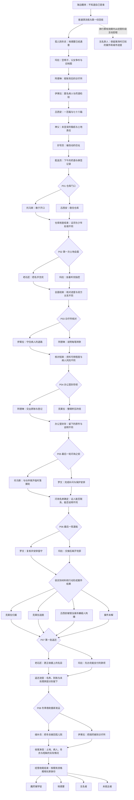

# 主线分支流程与故事梗概｜讨论稿 v01

2026-10-10。供组长讨论与定稿。此稿提出新的章节和选择密度，不覆盖既有案件事实、身份规则、正文或路线契约，不表示内容已经接入游戏。

> 后续已按用户示意图改为实际路线图：[路线框架与流程梗概 v02](主线路线框架与流程梗概_v02.md)。当前编辑器暂排18轮主线、36个交替日，支持跨轮分岔与远处汇合；本篇32天与八组成对节点保留为讨论来源，不代表编辑器当前排期。

> 2026-10-10 用户进一步确认：普通愿望与主线逐日交替，首日普通、次日主线；八组选择是剧情节点，不是八回合。新增[可编辑故事图](主线故事图_v01.json)，由[本机剧情编辑器](../../../scripts/story-editor/README.md)编辑。当前8个铺垫主线日加8个选择主线日暂排成32天，旧18天、票期、资源与考核仍需另行重排；下文三组旧G的日程不再作为新排期依据。图的持续修改以JSON为当前稿。

依据：[案件与角色](../../设计/寄往人间_主线案件角色档案与完整故事线.md)、[既有节点表](寄往人间_主线节点表_v01.md)、[既有路线契约](主线状态与路线契约_v02.md)、[身份结局规则](../../设计/寄往人间_五类玩家身份与结局判定规则.md)。现有主线正文仍是待重写稿，普通订单已定稿文本不随本稿修改。

## 一、先讨论故事的形状

可以做三种结构：完全分开的故事树，选择越多越难收尾；只保留少数决定结局的选择，规模小但难以形成后期的连续抉择；或者让每轮选择展开数种后续，再带着不同的人物处境回到下一场共同事件。

本稿推荐第三种。前段认识人，中段发现秘密，后段连续选择，最后分别交代案件、城市后续和玩家身份。暂拟八组成对节点，其中六组在案件结果形成前，两组在结果后的收尾。组数、顺序及新增冲突都属于提案。

二选一暂按现有玩法理解：两封漂流瓶同时出现，只能实现其中一个愿望；选定后仍须熬药，药效决定人物如何行动。人间不知道魔药铺，正文写他们当时的念头，由这些念头形成漂流瓶。下文的“帮助谁”是作者说明，不是人物向店主求助的台词。

“汇合”只表示进入共同的大事件。例如两条路都进入办公室封存，但一条已有原账送达，另一条只有被整理过的目录；两条路都到达最后一班船，但警方和证人的处境不同。已经发生的伤害、递交和离开不因汇合被清除。

## 二、故事梗概

一个不记得自己是谁的人，在海边经营魔药铺。他从漂流瓶里的文字熬制魔药，起初遇到的只是吃饭、出门、干活、同家人相处之类的小事。人们后来怎样生活，也随着新的瓶子陆续抵达。

灰港慈善家埃德蒙·维尔死后，越来越多念头与他有关。孤儿院担心冬衣，女儿想保住父亲的名声，账房藏着假账，医生藏着不能登记的病人，商人的仓库少了二十四箱物资。每个人都有理由隐瞒，也各自描述着不同的埃德蒙。

旧地图和接收文件揭开维尔家族抢地的过去。埃德蒙成年时参与接收土地并从中获利，后来做过的慈善不能抵消它。与此同时，两份登记上，同一户人家的地址却不相同；一些早已递交的举报，从未抵达埃德蒙手里。他死前准备公开旧债，也准备结束秘书克莱拉对信息的控制。

玩家逐渐接近那瓶药酒的经手过程，却也开始面对连续的两难：谁先开口，哪份纸能留下，谁承受公开资料的风险，谁还愿意参与问询，最后一班船开走前有没有人真正接班。帮助一个人完成愿望，未必帮助案件；让许愿者满意，也可能使另一个人失去机会。

克莱拉始终是调换药酒的真凶。她是否归案，取决于已经抵达并核实的材料、证人的处境和人间实际执行的行动。案件之后，土地能否返还、救助能否继续，还需要人继续办事。最后，魔药铺收到属于玩家的那一个结局：留下、离开、认出过去，或用保留下来的词语说出自己的愿望。

## 三、总体流程图

方括号是事件；菱形是成对选择。P 为本讨论稿编号，不是正式内容 ID。图中同一汇合框在不同路线里要写不同版本。

旅行票是跨阶段的主动出口，虚线从开端引出只为图面简洁，不表示只能在教程时买票。错过愿望场景或选择不参与时，继续报告默认行动和未办事项；流程图展示完整参与路线，不保证所有路线都完成每次会面。

## 四、开端至秘密浮现：先让玩家认识人

沿用 M01～M08 的叙事功能。前四个主线订单先不改为二选一，给玩家机会认识双方；其药效后续已经开始积累差异。

| 节点 | 故事梗概 | 本阶段分支与留下的东西 | 下一节点为什么出现 |
|---|---|---|---|
| 开端 | 玩家醒在海边，记不起姓名，通过普通愿望和回信学会经营 | 普通人对相同效果的反应不同，建立“愿望完成也有代价”的经验 | 新瓶子开始提到同一位死者 |
| M01 冬衣 | 缝补员已经量好孩子们的袖长，却不知道今年冬衣还能否送来；她想起长期在捐衣场外举地契的老石匠 | 信息节点，先建立受助者与反对者的不同处境，不让玩家立即判断谁是好人 | 死者女儿正在整理遗物 |
| M02 空椅子 | 玛拉不愿再被父亲的名字激怒。她藏过赔偿文件，也收到了葬礼上那位老石匠留下的图 | 能坐住并承认取文件；说得太急使关系恶化；讲不清争吵或拖延整理。副本与原件取得情况各自记录 | 文件和整理会把救助会的账房带入视野 |
| M03 假账 | 阿德琳承认钱不在账上，也不在自己口袋里，而是送到了旧港诊疗所 | 有限说明并保护代号；过度信任使实名流出；代号对应模糊或没有及时开口 | 玩家需要理解她保护的是哪些人 |
| M04 匿名病人 | 伊莱拉想回答调查，又怕回答会使病人被带走；药酒检验摘要在此出现 | 回答并保护病人；把名字说给不应取得的人；自己的转诊经过说不清或问询停滞。检验材料不因本人低星消失 | 善款去向与药酒疑点使物资供给也受检查 |
| M05 少掉的箱子 | 吕西安面对一百箱与七十六箱的差额，也隐瞒着派人寻找运输记录的行为 | 自己面对核查；威胁工人；记不清调货或拖延核查。运输罪证与谋杀证据分开 | 埃德蒙生前已经准备处理这些问题 |
| M06 稿纸 | 神父保存的稿纸说明埃德蒙准备承认成年时参与抢地，也准备重审账目和投诉 | 信息节点，确认责任与改革意向；尚未证明赔偿执行，更不能用被杀抵销旧债 | 为何这些投诉以前没被看见？ |
| M07 两处住址 | 西蒙发现同编号的收件与退件地址不一致；土地申诉也只进了接收栏 | 信息节点，把怀疑引向收信流程；K42物资举报与土地申诉分开 | 配送副联提供另一个可以交叉核对的编号 |
| M08 下午的药酒 | 乔纳说明下午已送妥药酒，后来有人要求换签。他没见过瓶中内容被调换 | 信息节点，得到V17副联；提前给出封存、人手和船期的线索，夜间进出不再等同调换时机 | 托马斯知道跑腿与仓库见闻，却未必敢说 |

## 五、八组成对节点：每条路先写梗概

下面每个候选列三类主要后续，用来讨论因果和人物。它们不是完整药效分区，也暂不套固定星级。正文阶段再决定哪些节点需要五支或更多；同一种星级可以容纳不同后果。

所有“未选方”都继续按自己的能力与动机行动，不静止、不自动遗忘、不免费提供只有所选订单才取得的东西。表中提到核对、递交、到账的成功，须在后续写出实际过程或凭据。

### P01｜仓库门口

保留原 G01 的中心冲突。托马斯带着仓库见闻准备开口，吕西安想把当晚的核查掌握在自己手里。两人的行动争夺同一处门口的发言与接待机会；一方行动之后，另一封原本的当晚愿望不再处于相同场景。

| 选择 | 后续梗概一 | 后续梗概二 | 后续梗概三 |
|---|---|---|---|
| 托马斯：敢于开口 | 他先整理号码与见闻，到警备所递交证词，得到安全接待 | 他冲去仓库当面质问，被赶走，躲到临时落脚处，朋友也受到惊吓 | 他虽敢说，却讲不清号码与先后；纸张仍在，口述暂不可靠 |
| 吕西安：稳住仓库 | 他控制核查顺序，把少年挡在门外；少年藏好未送达的纸 | 他镇定却强硬地威胁少年，工人记下威胁经过，形成另一类旁证 | 他能面对人，却说不清自己的调货安排，仓库旧记录仍可查 |

汇合事件：仓库核查结束。留下少年位置、完整证词是否正式送达、工人的态度和运输案资料。威胁旁证不能替代少年关于换签的见闻。

### P02｜旧图与住户名单

新增组，扩展原 L01。玛拉已核对旧图，邀请老石匠带名单来。他怕自己一见她就只会骂她父亲；她怕听见葬礼上的话，又把人赶出去。两封念头围绕同一场会面：帮助一方完成本场景后，另一人的原愿望时机结束。双方能否互相配合，仍受此前处境影响。

前置没有完成核对或邀请时，不凭空安排成功会面；先收到待核对的进度信，再决定是否进入这一组。新增组须在定稿时补出确切邀请与互斥场景，不能用全局“每天只能一瓶”解释。

| 选择 | 后续梗概一 | 后续梗概二 | 后续梗概三 |
|---|---|---|---|
| 老石匠：把名字念完 | 他按图逐户说明，玛拉找到遗漏的家庭，双方约好下一次核对，仍不握手 | 他坚持诉求却不断指责，名单只核对一部分；玛拉留下材料，中止当日会面 | 他对亲历驱离的细节说不清，只能以地契和其他住户材料继续核对，不能据此否定全部旧案 |
| 玛拉：坐着听完 | 她让对方讲完，也承认文件上的父亲签名；核对得以开始 | 她不再发火，却把归还称为慈善，老石匠要求更正，两人停在名目争议 | 她拖延或回避回答，会面没有完成；已收到的地图和契据仍留待核查 |

汇合事件：第一次会面告一段落。留下已核实家庭、尚未对上的地块和双方愿意继续接触的程度。听完、认错、答应付款、实际付款是不同进度。

### P03｜账页与病床

新增组。原有假账说明之后，出现一次面对面的核对。阿德琳想完整说明转款对应关系，伊莱拉希望先把病人的身份与去处保护好。提案场景是同一次核对开始前：完整说明若先在多人面前展开，病人转移与匿名说明的原安排便改变；若医生先关闭公开接待、安排隐蔽核对，原公开说明会也不能照旧进行。

两人都可以有合理愿望。不能把阿德琳的勇气必然写成泄密，也不能把伊莱拉的保护必然写成阻碍调查。

| 选择 | 后续梗概一 | 后续梗概二 | 后续梗概三 |
|---|---|---|---|
| 伊莱拉：守住病人的退路 | 她提出匿名核对办法，把日期与用款凭据给调查者，病人留在安全处 | 她急于把人送走，遗漏接续治疗与交接，病人虽离开却暂时得不到原来的照料 | 她把所有询问都拒之门外，病人没有新增暴露，资金对应也停在未核实 |
| 阿德琳：说明每笔转款 | 她分开账页和实名说明，在有权限的范围内完成核对 | 她想一次讲清，当众说出不应公开的对应，病人被叫去进一步核查 | 她记不清代号，只能留下金额和日期，等其他凭据补充 |

汇合事件：本轮核对结束。留下资金去向的核实程度、身份曾否暴露、病人实际所在及治疗交接。此组不免费提供尚在柜中的 R17 原登记，不因保护病人删除药酒检验摘要。

### P04｜封存前的档案室

保留原 G02。阿德琳要在封存前递交原账与登记，克莱拉要按旧流程处理积压的信。两人争夺同一批原件在封存前的处置顺序；已经交出的原件不能被后来的整理远程抹去。

| 选择 | 后续梗概一 | 后续梗概二 | 后续梗概三 |
|---|---|---|---|
| 阿德琳：交出原件 | 她交出原账与原登记，并把匿名对应分开说明，材料可供后续问询核对 | 她交出全部资料，证据有效，但新增病人暴露；既有暴露不重复算成第二次同一事件 | 她拿到纸却说不清对应，或迟缓到未能取出；“纸在手里”与“已说明”分开写 |
| 克莱拉：处理积压的信 | 她裁下旧退件地址、整理目录，准备离城；原账没有自动送到警方 | 她更敢于解释自己的流程，主动写下 Q17/V17 的具名说明，留下可核对的矛盾 | 她对 K42 处理经过模糊或行动迟缓，归档出现错位；不因此凭空产生谋杀自白 |

汇合事件：办公室封存。留下原件存续、原件持有人、解释是否完成、克莱拉是否准备离开。船期与值守提示对两边都抵达，不藏在某个候选的成功分支里。

### P05｜证人的住处

新增组。调查者希望在最后问询前补清少年的跑腿见闻；托马斯想和伙伴离开被人盯上的临时落脚处。两封念头围绕同一次补问安排：少年如果先走，原地点的问询必须取消或另找联络；调查者若先实施接待与保护，少年原本自行离开的安排便改变。

这是一组随 P01 改写候选梗概的节点。已经安全递证的路线，谈的是补问与保护；尚未递证的路线，谈的是怎样获得第一次正式接待；记忆模糊的路线，双方承认能补充的内容有限。不复制相同来信假装此前经历不存在。

| 选择 | 后续梗概一 | 后续梗概二 | 后续梗概三 |
|---|---|---|---|
| 托马斯：同伙伴离开 | 他告知安全联络方式后离开，已递交证词仍在，日后可联系 | 他急着走，未留可靠地址，警方只能使用此前实际取得的内容 | 他离开了，却对见闻更讲不清；朋友仍能说明自己亲历的事，但不能替他编出换签目击 |
| 罗文：完成补问与保护 | 他先安排安全接待，再核对少年尚能说明的见闻，形成有来源的补录 | 他只顾问完，未落实保护，少年完成一部分说明后拒绝继续接触 | 他拖延或沿着原偏见发问，补录失败；已有可信证词和纸面反证仍保留 |

汇合事件：最后一轮问询名单确定。留下能否联系、本人是否愿意继续、可靠说明已到哪里。补录必须写出实际问询，不能靠选罗文就恢复遗忘的记忆。这一补录机会是新提案，若采用，须修订旧路线契约的证词取得入口；当前旧契约仍只认可原有安全递证路径。

### P06｜最后一班船

保留原 G03。罗文要完成复核并安排值守，玛拉要交接后离开宅邸。二选一发生前，玩家已经知道船期、人手缺口和玛拉的离开时刻。两边都可以让许愿者满意，但满意并不保证相同案件结果。

| 选择 | 后续梗概一 | 后续梗概二 | 后续梗概三 |
|---|---|---|---|
| 罗文：复核与值守 | 材料完整，问询核实克莱拉调换药酒，实际控制她并安排出口拦截 | 材料不足，他仍有效安排封控，却不能把其他人的罪行当成谋杀证明，案件未解 | 他草率拘捕或行动迟缓；错抓吕西安必须有既有偏向、缺可靠反证等依据，不能由一个药效自动指定错抓 |
| 玛拉：交接后离开 | 她交清钥匙、文件与地址，去暂住处；没有实际警备时，已计划离开的克莱拉可能利用窗口 | 她冲动离开，交接有遗漏；遗留问题真实存在，但不凭此保证克莱拉登船成功 | 她未能及时离开，临时照看仍在；克莱拉未利用这班船，不等于已经归案 |

汇合事件：当日问询与船务行动结束，形成四类案件结果之一。原船期的逻辑保留：书面交接不等于警备到岗；未选罗文不免费得到最终复核；有离开计划、有实际窗口且无有效控制时，才能写离港。新增前序节点若改变这些条件，须逐条重排与验证。

### P07｜第一批返还

新增组，延伸 P02 的土地线。材料已核实且有可支付资产时，出现第一批实际交接。老石匠希望收据明确写“返还”，玛拉想赶在当晚把有限的款项交到急需过冬的家庭手里。拟定冲突是当批收据的签发：要求更正文书会改变当晚手续，照原草稿支付则留下“慈善捐赠”的旧叙述；以后仍可纠正，不把两件事设成永远互斥。

若核对未完成或资产尚不可支付，本组改写为催办与交接准备，不能沿用“第一批已可领款”的来信。未完成核对的路线也会收到进度，不被自动补成成功返还。

| 选择 | 后续梗概一 | 后续梗概二 | 后续梗概三 |
|---|---|---|---|
| 老石匠：把名目写对 | 他逐项说明，更正收据后办成当批返还；实际赶不上当晚的家庭仍另记等待 | 他坚持名目却替其他家庭拒绝领取，引发受害者内部争执，别人自行表达要先收款 | 他把文书留下待核，款项尚未交接；坚持诉求不被写成已经到账 |
| 玛拉：先办支付 | 她说明这是偿还债务，并兑现已核实的部分款项，未处理的家庭继续登记 | 她实际付了钱，却仍使用慈善收据；老石匠拒绝致谢，收款家庭保留追责权利 | 她只承诺基金或拨款，没有款项交接；尾声明确仍未兑现 |

汇合事件：当批交接结束或延期。留下哪些家庭收款、哪些取回资产、哪些还在等，以及公开责任是否更正。老石匠无权代表所有家庭原谅或拒收，玛拉也不必因有限赔偿就与他和解。

### P08｜过冬的货车

新增组，给城市后续一个具体收尾。缝补员等冬衣，伊莱拉等煤与药材。拟增加一封前置信息：本期物资确实到货，但当日仅一趟车可发，两个接货安排冲突。由人间经办人与接货者实施安排；玩家的药影响他们怎样争取、核对和交接，不直接凭空生成物资。

这是本稿新增的运输情境，尚待组长确认。没有实际到货的路线，候选必须改为协调已有的小规模接济，不能写成大批冬衣或煤药凭空齐备。另一处延迟的损失须具体写，不安排无预兆的死亡惩罚。

| 选择 | 后续梗概一 | 后续梗概二 | 后续梗概三 |
|---|---|---|---|
| 缝补员：接回冬衣 | 她核清件数和短缺，安排本趟接货，孩子先穿上已到的冬衣；诊疗所的延期另交代 | 她急于领走，未核对尺码和件数，有孩子仍缺合身衣裳，须再次调换 | 她未完成领取安排，货仍在中转处；不能把已到仓写成已发到孩子手上 |
| 伊莱拉：接到煤药 | 她按已知病情和现存物资安排接货，实际能覆盖的患者得到照料；孤儿院另记等待 | 她把资源集中给眼前最急的患者，另一些人继续等待，她必须面对分配争议 | 她的交接没有完成，诊疗所只得到已明确的小额接济，短缺仍在 |

汇合事件：本期分发告一段落。收到人间写来的件数、交接和短缺反馈。物资到货、经手方式、实际分发和仍未覆盖者分别交代；救助会改名或重新挂牌不自动改善这些事实。

## 六、案件和身份怎样收束

案件轴沿用四类结果，不增设“道德分决定真结局”。

| 案件结果 | 故事收束 | 仍会继续的事 |
|---|---|---|
| 真凶归案 | 问询与具体经手记录支持克莱拉责任，且确实完成控制或拘捕 | 受害者不会因此自动收到土地与款项；救助供应仍待交接 |
| 真凶逃脱 | 克莱拉确实利用窗口离港，警方留下已取得材料和明确缺口 | 她未带走的土地材料仍可办理；人间是否继续追查另写实际进度 |
| 错抓他人 | 吕西安以错误的谋杀嫌疑被拘捕，运输案事实不能填补药酒证据缺口 | 错误不在收尾里自动纠正；其他责任可分别追查 |
| 案件未解 | 到期限仍不能核实谋杀责任或促成结果，可已有有效封控，也可没有 | 可以已经返还部分土地，也可以仍停在核对，按已发生的事写 |

最终身份继续读取既有资格：有效期内主动买票启程是无名旅人；普通终局先判学徒，再判非学徒且真凶归案的埃德蒙，再判达到留存词条标准的无名者，其余为未抵达者。新增订单是否必需、学徒覆盖集合、经济与日程，必须另行讨论，不能以本稿八组直接替换原三组考核。

| 身份 | 最后的故事梗概 |
|---|---|
| 无名旅人 | 玩家在票期内启程，带着截至离场时看过的回信离开；尚未完成的事仍未完成 |
| 魔药铺学徒 | 玩家把铺子安置成生活的地方，完成当前路线的订单考核，得到上一任店主认可；案件另有自己的结果 |
| 埃德蒙 | 真凶归案、学徒条件未达后，玩家收到埃德蒙的瓶子却剪不下词，认出这是自己的愿望；既看见秘书的罪，也面对自己的旧责任 |
| 未抵达者 | 玩家可以剪下埃德蒙信中的词，随后收到明确属于自己的旧求助记录，发现自己的声音也曾被压下 |
| 无名者 | 玩家没有可确认的过去，却保留了来自他人的词；他拼出“我想……”并封瓶投海，以自己的愿望结束旅程 |

同一案件结果可以抵达不同身份，同一身份也可以带着不同城市后续。最终呈现顺序建议为：案件短尾声 → 实际抵达的土地与救助来信 → 玩家身份演出。收尾不得泄露提前离场之后才会发生的事情。

## 七、怎样让前面的选择继续有用

以 P01 托马斯为例：安全递证后，P05 的来信谈的是已经做过的证言、补问与保护；冲动对质后，来信要先交代他藏在哪里、怎样恢复联络；记忆模糊后，所有人承认他无法说明某些细节，不能到下一幕重新报出精准号码。三路都能抵达末班船这一事件，却有不同的问询输入。

每个节点交付时都按同一套顺序整理：进入前的可知信息、两人的处境、愿望互斥的具体场景、所选方的多种直接后续、未选方实际行动、后续数节点如何回应、最终尾声怎样引用。某个结果若只改变回信措辞而没有人物或后续差异，应缩成文本变体；若改变了真实状态，就应保留为剧情分支。

不同情节不需要组合成成千上万个完整稿。后续围绕几个对当前场景有用的事实写版本：证词可靠且已递交；材料持有但尚未说明；本人已经离开但可联络；款项兑现给了具体家庭；病人曾暴露且正承担后果。最终组合这些已有事实，不能把所有支路揉成同一段“大家都好了”。

## 八、本稿最需要先判断的地方

1. 八组成对选择的密度是否合适，还是先保留六组。新增 P02/P03/P05/P07/P08 都尚待认可。
2. 案件结果形成后，还保留 P07/P08 两轮选择是否合适。它们让土地与救助成为可参与的收尾，而不是只读尾声。
3. P02/P03 的同场景互斥、P05 的补录机会、P07 的收据办理和 P08 的单趟发运都要在正文前写实；任何一组若两愿望可以自然同时完成，就改场景或取消成对设计，不硬加魔法限制。
4. 章节顺序认可后，再逐组定来信与分支正文，最后才定属性阈值、资源账、日程与接入。现有18天、船期与旅行票不能因为加组数而悄悄改动；新方案的同日投放与完整路线须重新验证。

本轮只写梗概与流程。无需在这一轮同时定星级、配方、所有数值和程序字段。
