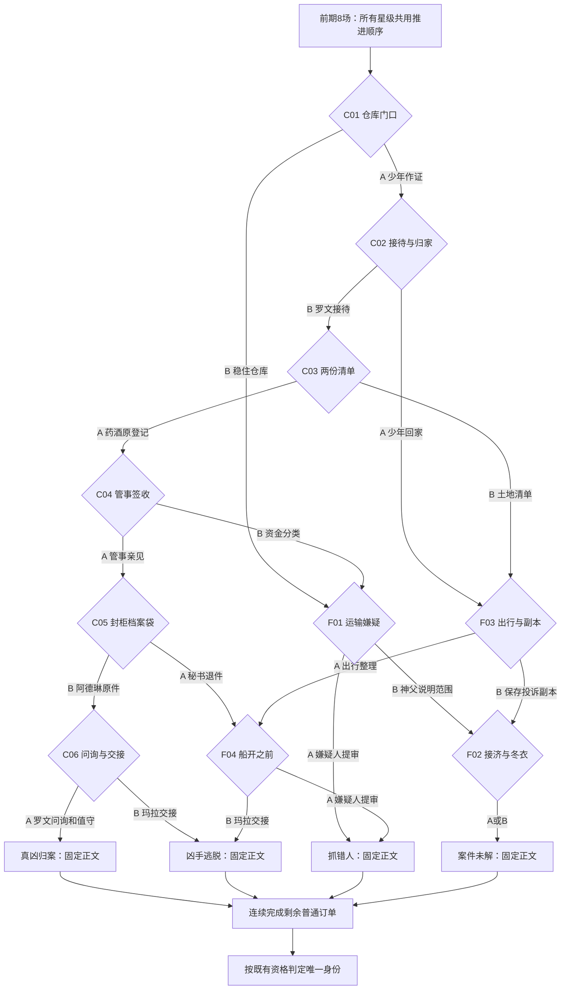

# 主线唯一抓凶路线与提前结局重构 v06

2026-10-11。用户确认采用“唯一抓凶选择链、星级不改变主干走向、允许提前剧情结局、主线结束后连续普通订单、四份固定剧情结局”的方向，并要求先编排记录，暂不修改编辑器。

同日复核修订：补明日间反证的独立来源、选择前可知的办理时限与未选者停住的原因，调整部分低星损失，修正离港结局的共用事实。节点、出口与数量不变。

**2026-10-11 经用户授权，已同步到编辑器，并随后将 M01《冬衣》改为单愿望订单：现为104节点、163连接，10场二选一、75条订单后续、四份固定剧情结局草稿。** 最初v06迁移为101节点、158连接、72条后续；本次新增M01三档并接回M02。旧图已通过编辑器版本校验保存自动备份。本稿取代v05的分路与组合收尾设计；运行游戏、数值和日历尚未接入，不把两个版本混用。编排层只用于箭头布局，不代表固定游戏日期；提前结果到达即可揭晓。

M01 [来信正文已确认](M01_冬衣_来信定稿_v01.md)，[模板式三档后续已确认](M01_冬衣_模板后续定稿_v01.md)，明示心愿补句仍待确认。后续采用共用正文，只替换决定三档结果的关键句段；不各写一篇独立故事。

参考：[v05梗概](主线愿望结果与收尾梗概_v05.md)、[v04互斥与回溯](主线互斥愿望与回溯契约_v04.md)、[固定案件事实](../../设计/寄往人间_主线案件角色档案与完整故事线.md)、[身份规则](../../设计/寄往人间_五类玩家身份与结局判定规则.md)。

## 1. 本次确定的结构

1. 克莱拉调换药酒的案发事实固定。玩家只在魔药铺读瓶子、配药和接收后续，不增加亲自调查或指认凶手界面。
2. 抓到真凶只有一条**二选一序列**：C01-A → C02-B → C03-A → C04-A → C05-B → C06-A。这里的“唯一”指选瓶序列唯一；每一瓶有三个星级文本，因此不是只有一条文本路径。
3. 所选瓶的一星、二星、三星都通向同一个下一场景。主线选瓶决定调查方向，星级记录许愿者对当次结果的满意程度。此次提案也让失败支线的三档共享出口，避免重新长成复杂树。
4. 一星仍必须有真实损失，如身份暴露、争执、隐私受损、关系恶化、本人留下难堪。不能把必需纸件毁掉、关键亲见永久遗忘、问询完全取消或值守完全未执行，再宣称剧情照常抓凶。
5. 一次偏离主干，后续只能抵达错抓、逃脱、未解之一；不增设独立材料补救路线，不重新捞回已丢弃瓶子。
6. 四个剧情结局各有一份固定正文。各自可以有多个入口，但不根据前期星级或人物处境拼装结尾段落。
7. 剧情结局确认后停止主线投放；剩余普通订单按既有顺序连续完成，再进入身份结局。早结案不会少掉必需普通订单。

这次保留“未选愿望永久关闭”和完整回溯快照；取消“低星导致另一种下一场景”“主线所有路线都等第18轮揭晓”“案件结束后继续两组主线返还与救助”。

## 2. 数量与阅读顺序

| 内容 | v05 | v06编排目标 |
|---|---:|---:|
| 后期二选一场景 | 32 | 10：6个主干＋4个短支线 |
| 后期所选瓶后续 | 195 | 60：10场×2瓶×3档 |
| 前期单愿望后续 | 24，含重复场景版本 | 15：5份愿望各3档 |
| 所有主线订单后续 | 219 | 75 |
| 剧情结局正文 | 组合经历收尾 | 4份固定文本 |

订单后续较v05减少144条，约66%。75条是编排中逐瓶结果的数量，不代表75篇正文已定稿。信息节点、两瓶来信、结局通知和身份正文另算。

前期保留8场认识人物的内容；其中3场信息、5场单愿望（M01～M05）。之后只有6次选择能够一路走到归案。偏离主干后最多再经历2场二选一便收束，不把每条失败线扩写到同样长度。

主线尚有即时事件时沿用普通与主线交替。等待已经公布的航次时，不凭空制造主线瓶补齐单双日；该段可继续投放普通订单。剧情结束后则完全切换为连续普通订单。

## 3. 前期8场：同一顺序，不按星级复制场景

| 顺序 | 场景及用途 | 三档可变部分 | 所有版本共用的推进事实 |
|---|---|---|---|
| M01 | 冬衣：艾丝特想静心补现有旧衣、量尺寸并好好回答孩子；同时建立遇害消息与石匠抗议 | 3星：旧衣补好、尺寸量齐，耐心回答；2星：活做完，却催责伤害孩子；1星：吼出死讯，孩子恐惧，缝补量尺寸中断。三档共用模板，只替换关键句段，正文已由用户确认。 | 来信的死亡事实、旧收条与抗议记录保留。厚衣仍有缺口；教区寄存捐衣不保证送达。三档确认后同去M02。 |
| M02 | 空椅子（[来信与模板后续已定稿](M02_空椅子_来信与模板后续定稿_v01.md)）：玛拉想坐下来整理父亲留下的争吵与文件 | 3星：说出自己的行为并能继续整理；2星：整理了部分却又维护父亲、同亲人争执；1星：说得失控，无法继续谈私事，觉得难堪。 | 石匠旧图及文书室保存的接收依据已各有来源。它们不靠玛拉本瓶成功开柜生成；本瓶不处理药酒原登记。 |
| M03 | 账外款项：阿德琳逐笔核清旧款、编出明细，病人实名另存，主属性方向为理性；[来信与模板后续已定稿](M03_账外款项_来信与模板后续定稿_v01.md) | 3星：款项明细齐全，实名另存；2星：在明细旁添上一位病人的名字，引来单人追问；1星：一并交出实名册，多名病人受扰，她后悔。 | 官方面前已存在的转款单只证明去向，三个版本都指向诊疗所；患者处境可以不同，药酒检验并非从患者实名推出。 |
| M04 | 匿名病人：伊莱拉想放轻松回答问话、照常照顾病患；[来信、前置承接段与模板后续已定稿](M04_匿名病人_来信与模板后续定稿_v01.md)，主属性方向放松 | 3星问话与照料照常完成；2星问询拖延，照料延后完成；1星照料中断并迁怒患者，患者不再肯接受她的照料。M03三种前情按实际星级代入。 | 医者已检验的药酒摘要由独立纸件送到调查员，不靠伊莱拉本次口述或患者是否留下决定存在与否。检验摘要措辞仍为独立附件草稿，不包含在本次私人正文定稿内。 |
| M05 | 仓库差额：吕西安想亲自站在仓门口答核查员的话；[来信与模板分支草稿](M05_仓库差额_来信与模板分支草稿_v02.md)待确认，主属性方向暂拟勇气 | 草稿：3星亲自到场并答话；2星发火、逼工人重搬重数；1星推责并逼库管签认缺货，被当面拒绝。低星损失落在工人劳动与管理信任，编辑器M05尚未改写。 | 核查员实际点到76箱，对照账面100箱；运输疑点成立，但不能当作谋杀证明。此阶段没有已核实的案发日不在场反证。 |
| M06 | 稿纸：神父想记清维尔最后来访的谈话；[来信与三档草稿](M06_稿纸_来信与模板分支草稿_v01.md)待审，主属性暂拟忆起 | 2026-10-11用户要求改为愿望订单。拟三档：回忆清楚并据实记述／记清却偏袒亡友、冷落受损者／谈话与稿纸混写，核问后撤回不确定部分。结果节点待审定后同步，三档同开M07 | 埃德蒙成年参与抢地、获利并准备重查账目与投诉；亲笔稿独立抄录，不随星级消失，不构成被杀后的免责。 |
| M07 | 两处住址：西蒙发现物资投诉被退件 | 信息，不评分 | 保存投诉副本与职责记录；尚未取得药酒的完整原登记。土地申诉与物资举报分开。 |
| M08 | 下午的药酒：乔纳交代配送与换签请求 | 信息，不评分 | 配送收条抵达；管事签收，随后收到换签请求。谁换了瓶、瓶中是什么，还需后期核实。托马斯跑过腿，给C01的出现提供原因。调查员已向供货方和外港税关调取当日原件，答复尚未抵达；港口常规航次及秘书离任交接也在此交代。 |

M01～M05均是私人愿望，不要求其一星把本人愿望完全实现。M01补现有旧衣，F02-B领后期教区寄存冬衣，属于不同事情，不重发原愿望。公事纸件的固定推进必须在前情交代实际来源，不能用“虽然失败，调查员还是拿到了全部资料”一句补齐。

前期不安排提前错抓、逃脱或隐藏成功条件。这样，前期低星不破坏后来六次正确选瓶必然归案的约定。

## 4. 唯一抓凶主干：六次选择

以下A/B是本稿与编辑器一致的作者编号；最终玩家界面不提示“正确”，候选位置也不以全部A或全部B形成规律。关键事实在所选事件中实际产生，不能靠魔药让真凶自白。

### C01｜仓库门口

托马斯带着跑腿留下的纸，怕开口后被仓库的人认出来。吕西安面对点数，想把核查现场稳住。两人争夺现场接待与发言机会。

| 瓶子 | 三星 | 二星 | 一星 | 共用后果与出口 |
|---|---|---|---|---|
| A 托马斯：敢把自己见过的经过交给核查员 | 到侧室说清自己的见闻，姓名未公开，放心许多。 | 当场争起来，但纸与实际见闻已留下；事后怕被认出。 | 当众说出见闻，姓名传到仓库，他十分后悔暴露自己。 | 三档都已递交原纸，并确认本人确实受过换签跑腿指派；尚未确认瓶中内容。进入C02。 |
| B 吕西安：稳住仓库核查现场 | 控制点数秩序，少年没有进入接待处，他满意。 | 核查完成，却与工人争执，他觉得局面难看。 | 大声驱赶围观者，核查员仍记下差额，他的威信受损。 | 托马斯的原作证瓶永久关闭；其纸与换签见闻没有进入案卷。转F01。 |

进入C02的原因：少年已作证并被认出风险上升，需要安顿和进一步接待。选商人后不会另送一封“再让少年作证”的瓶子。

### C02｜警备所的长凳

罗文已读到少年交来的纸，想安排接待、补问与暂住处。少年想立刻跟伙伴回家。两者争夺少年当天是否继续留在接待处的安排。

| 瓶子 | 三星 | 二星 | 一星 | 共用后果与出口 |
|---|---|---|---|---|
| A 托马斯：同伙伴回家，结束今天的等候 | 结伴回家，留下住址；他不再害怕夜里孤身走。 | 自己先走，伙伴追了一段路，他疲惫又不好意思。 | 急着回去，同接待人争吵，伙伴也生气；他虽到家却很后悔。 | 已有有限记录保留，罗文本期额外接待与补问未实施；关键换签对象未对齐，也不再补做。转F03。 |
| B 罗文：把本次接待、补问与暂住安排好 | 安稳补问，少年知道今晚有人照看。 | 补问完成，等候太久，少年向他抱怨。 | 补问和暂住办完后，他为催人办手续，在拥挤的走廊念出少年的姓名与住处。少年责怪他没有守住保密约定，罗文懊悔；已签存的记录不变。 | 三档都核准本次跑腿、原纸与签收关系，并使少年保持可联系；不靠其口述认定毒物。进入C03。 |

进入C03的原因：补问发现签收请求与文书编号不一致，罗文将具体编号交给能合法查阅文书室原簿的西蒙。

### C03｜文书室的两份清单

西蒙接到明确的原登记核查事项；玛拉想先核对家族接收土地的清单。两份文件同在封存工作时段内，两人有各自的急事。

| 瓶子 | 三星 | 二星 | 一星 | 共用后果与出口 |
|---|---|---|---|---|
| A 西蒙：把指定的药酒原登记核对并交妥 | 分清收件、撤签与重新经手，交妥摘录和原页来源。 | 原页核完，却多解释了其他争议，交件时与人不快。 | 原页核对交存后，他想证明自己也曾拦下退件，却当众念出投诉副本上的住址。来询问的住户因此拒绝再向他讲私事，他后悔越过了保密边界。 | 三档都留下可追索的原页、日期和实际经手人，未宣判调换。进入C04。 |
| B 玛拉：核清家族接收土地清单里的责任 | 认下有依据的接收责任，分清待联系家庭。 | 仍称父亲有苦衷，核清部分后与经办人争执。 | 话说得伤人，被石匠当面质问，她羞愧；原有土地资料照旧。 | 土地订单的直接后果保留，但本次药酒原登记未获核对；不把土地纸件充作药酒证据。转F03。 |

进入C04的原因：核实原登记上出现管事的签名与后续经手记录，调查员请他说明自己亲见的交接。

### C04｜管事的签收

管事想说清自己接过、放过的瓶子，怕替别人的行为担责。阿德琳面对新的分类催单，想分开资金与供货记录，怕运输差额算在她头上。

| 瓶子 | 三星 | 二星 | 一星 | 共用后果与出口 |
|---|---|---|---|---|
| A 管事：把本人亲见的第二次交接说明白 | 按记录说出另一瓶由克莱拉带来，确认自己放置的位置。 | 交代亲见，同时埋怨乔纳和秘书，事后怕得罪人。 | 亲见部分读回签认后，他还指责乔纳故意留下收条害他。乔纳拒绝再替他捎私人东西；他发现自己冤枉了多年熟人，羞愧却难以挽回信任。 | 三档都取得管事本人签认的独立亲见：谁带来另一瓶、本人接放了什么；不让他猜瓶中成分。进入C05。 |
| B 阿德琳：按这份新催单分开资金与供货记录 | 分开各栏，自己的转款不再同运输损耗混记。 | 整理时多说了几名病人，资料有用但隐私受扰。 | 急着自证，摊开姓名，病人失去信任，她后悔。 | 不生成未选管事的亲见证词；调查继续偏向运输与账目。转F01。 |

进入C05的原因：管事的亲见与登记相互对应，调查员发出明确封存清单。M08调取的供货方与外港税关答复此时抵达救助会收件处，由阿德琳按收件簿暂管，等待逐项签收移交。她原先保管的供货原件、留样交接记录也列入清单；克莱拉另收到退件整理催单。收到封包不等于调查员已取得并核准其中内容。

### C05｜封柜前的两只档案袋

阿德琳怕交原件时把病人的资料也摊开，想按封存清单交妥指定材料。克莱拉想把这一批退件目录整理完，以免离任后被追究失职。

| 瓶子 | 三星 | 二星 | 一星 | 共用后果与出口 |
|---|---|---|---|---|
| A 克莱拉：把本批退件目录整理妥当 | 交完目录，没有交出未被要求的原投诉，她觉得事情已办完。 | 急着解释裁址，留下具名辩解，引起后续追问。 | 整理时与同僚争吵，目录只交了可办理部分，她怕被问责。 | 三档都留在同一封存交接时段；不取得未选阿德琳原件，不恢复被放弃的管事说明。转F04。具名辩解仅是本批退件说法，不再开补救抓凶路线。 |
| B 阿德琳：将封存清单所列原件交妥 | 指定原件逐项签收，病人资料另封。 | 原件交妥，却多摊开一份实名对应，她为此不安。 | 因自证而公开实名，患者受到查问；指定原件仍已签收，她很懊悔。 | 三档都交存供货原单、留样封缄、经手来源，以及外港税关的在场记录与具名确认。经办人签收后实际核验，调查员同已有原登记、管事亲见和检验摘要对读，核清调换矛盾与吕西安的日间反证。进入C06。 |

关键桥接分为两项，均须在三档后续的共同事实中实际办理，不能只在下一节点条件里写“已经核实”：

1. **药酒来源**：调查员逐项对读供货签收、留样封缄、原登记和管事笔录，明确正常配送与第二瓶不一致。供货原单证明送出的物品、日期与经手来源，不能单凭这张单子证明吕西安本人身在何处。
2. **独立日间反证**：本稿补设外港税关当日验货记录，记有验货起止时刻、地点和吕西安本人在场签名；同包附验货官的具名确认，说明他在这段验货中亲见吕西安持续在场，中途未离开。经办人向税关核对原簿和确认来源，调查员再对齐原药酒送达至第二瓶接放的时段及两地路程。只有在覆盖整段关键时段、能排除本人往返参与该次宅邸调换时，反证才成立；不能用某一刻的货物签收或代办人签名替代。最终日历须满足这一覆盖关系。

该反证排除的是吕西安亲自实施本次宅邸调换，不替他洗掉盗运责任，也不单独证明克莱拉有罪。克莱拉的责任仍须由整条经手材料和C06问询核实。此附件属于本稿新增的来源设定；仅C05-B实际交存并核准，C05-A及其他短支线不自动取得它，核准后不得删除或降格为未证实传言。

船期前置：本场明确克莱拉订了封存交接日的末班航次，且交代官定换班和停止登船时刻；不写她此刻已离港。

### C06｜封存日的问询与交接

罗文收到来源相互对应的材料，想完成经手人问询并安排值守。玛拉想把宅邸钥匙和自己的差事交清，搬去同城姨母家。两人面对同一交接时限，各自想结束手头难事。

| 瓶子 | 三星 | 二星 | 一星 | 共用后果与出口 |
|---|---|---|---|---|
| A 罗文：完成本次问询与值守安排 | 按材料逐项问询，安排到岗；克莱拉的调换行为被核实。 | 问询完成，但接待拖延，现场多次抱怨，他觉得处理得不够好。 | 到岗、对读、笔录和拘捕都完成了，他却因不信同伴能办妥而反复召回查问，耽误同伴约好的照护换班。得知家人久等无人接替，他为自己的猜忌懊悔。 | 三档都实际控制人员，核实责任并正式拘捕克莱拉；进入E_TRUE。魔药不强制自白，结论建立在已核实材料和亲见之上。 |
| B 玛拉：把钥匙与本人差事交妥，搬去姨母家 | 交清自己的清单，按约搬居，终于能休息。 | 搬到姨母家，却漏交部分土地办理说明，需要解释。 | 她急着搬走，将应由本人解释的日常差事推给管事。搬居已成，管事却不愿再替她转交私信，她才察觉多年相处也受了损。 | 罗文未实施本瓶额外问询与值守。克莱拉按此前船期完成自己的离任手续并实际登船；玛拉的交接评分不决定克莱拉能否离开。进入E_ESCAPE。 |

取消旧设定中“玛拉没有离开，克莱拉就必须等她、因此错过船”的结局门槛。克莱拉本人离任手续由已在场的管事按清单办理；玛拉无拘禁权，也不是秘书离港的唯一许可人。未整理完的退件按未完清单封存，不写成有人免费完成了那份被丢弃愿望。

## 5. 四个短支线节点

短支线不提供回到C01～C06的边，也不补捞少年、原登记、管事、原件或罗文部署的被丢弃瓶。下列四场在相同缺口成立时共用同一内容，避免同一场因入口不同复制多个版本。

### F01｜运输账上的嫌疑人

从C01-B或C04-B进入。调查员掌握运输差额，却缺换签原纸或管事亲见；不能核实药酒第二次交接。上级催罗文交一份结案意见，神父收到新的追问，要澄清生前谈话并未指认杀人者。

| 瓶子 | 三星 | 二星 | 一星 | 出口 |
|---|---|---|---|---|
| A 罗文：把眼前这份嫌疑人提审办完 | 平稳做完已拟定的提审与报告，他觉得终于交了差。 | 提审吵起来，报告仍被采用，他为现场难看不快。 | 发怒逼问，报告仍按原有误判提交，他被责备。 | 三档都沿着运输差额误判谋杀，吕西安被错误拘捕；E_WRONG。三星表示罗文当次满意，不证明判断正确。 |
| B 神父：说明自己那次谈话到底能证明什么 | 讲清维尔曾谈过改革，没有指认下毒的人。 | 说明清楚，却替死者说了太多好话，惹恼受损者。 | 为死者辩护而争吵，最后仍留下本人实际听过的范围，十分懊恼。 | 本次补充是回应新的“谈话能否指认凶手”追问，不重发M06稿纸，也不取得药酒亲见。谋杀指控未被完成，进入F02。 |

这条支线没有经过C05-B，不存在已核实的吕西安日间反证。后续实际配置不得把已有反证的路线接进F01。

### F02｜案卷留下之后

调查员因关键来源缺失，将谋杀案转为待查，通知不再以账目差额代替药酒经手。与此同时，教区少量现存冬衣与诊疗所接济争用本次小车。这里是主线的最后一场生活诉求，案件已不会回到抓凶链。

| 瓶子 | 三星 | 二星 | 一星 | 出口 |
|---|---|---|---|---|
| A 伊莱拉：把这批现存接济送到仍在院的患者身边 | 点清接济，实际在院的人得到本批照料，她放心。 | 分配时起争议，照料只覆盖已点清的人，她心里不安。 | 她只顾应付围上来的人，没有按名单留出卧床患者的份额；推车走后，看见他们床边仍空着，她十分自责。 | 本批照料范围在后续中交代，不制造药酒证据；三档E_UNRESOLVED。 |
| B 缝补员：把眼下寄存的冬衣领到孩子手里 | 核尺码后领回，孩子穿上，她满意。 | 衣服到了，部分尺码不合，需调换。 | 领取混乱，只到了一部分，孩子仍等，她难过。 | 未选患者接济不自动完成；三档E_UNRESOLVED。 |

“未解”是本次游戏调查的收束，不宣称人间此后永远不再查案。案件待查通知在本场后实际抵达，不等固定末轮才播放。

### F03｜出行纸与投诉副本

从C02-A或C03-B进入。少年已离开或原登记没有核对，接待名单中已有对应缺项。秘书察觉当前调查仍未触及药酒交接，决定提前办完可交的公事，改订一班较早的常规航次；西蒙则担心自己保存的投诉副本丢失。

| 瓶子 | 三星 | 二星 | 一星 | 出口 |
|---|---|---|---|---|
| A 克莱拉：核清这次出行的文件与行李 | 核完文件，行李整齐，她觉得出发前的事已安排好。 | 带了不必带的东西，搬运麻烦，她懊恼。 | 她急着装箱，没扣紧的行李摔在湿地上，换洗衣物沾水，一件私人物件也磕坏了。航次和本人证件仍已办妥，她为损失烦躁。 | 三档公布同一已订较早航次及交接时限；未写已经登船。进入F04。 |
| B 西蒙：把仍在手里的物资投诉副本封存 | 分清原纸来源，保存投诉副本。 | 保存了纸，却多指责旁人，引起争论。 | 争吵使封存不体面，可办理的副本已留存，他害怕被责怪。 | 所存只有K42物资投诉，不含未核对的药酒原登记；未选出行整理不自动完成。转F02，以未解收束。 |

本场的出行愿望由提前订票的新事件引出；西蒙处理的是当前投诉副本保管，不重发C03指定药酒原登记查找。

### F04｜船开之前

从F03-A或C05-A进入。两种入口都已在上一场告知本条路线的航次、交接时限，且都未集齐唯一抓凶链。罗文被催办，准备按运输嫌疑做提审；玛拉想结束自己手里的钥匙和日常差事交接。

这里的误判过程必须明写：罗文没有核准第二瓶的供货与封缄，也没有取得吕西安的日间反证，误把撤签与再经手当成例行换签，将运输纠纷当作杀人动机。走过C04-A的路线虽已有管事亲见，仍被他错误地轻视；不能把这份证词删掉，或只说“资料不够，所以抓商人”。选罗文后，他实际按此错误判断执行提审和指控。

| 瓶子 | 三星 | 二星 | 一星 | 出口 |
|---|---|---|---|---|
| A 罗文：完成手头已安排的嫌疑人提审 | 平稳执行已有提审意见，他自觉办得利索。 | 提审争执，结案意见仍照原判断，他不满意过程。 | 失控逼问，受人责备；原有错误指控仍被正式提交。 | 三档E_WRONG；不生成未选原件，不把克莱拉的退件辩解变成药酒自白。 |
| B 玛拉：交清钥匙和本人日常差事 | 交清后离开宅邸，到同城姨母家。 | 离开前遗漏少量说明，管事随后向她核问。 | 与管事争吵，事情交得难看，她虽搬离仍不安。 | 三档均无罗文本次部署；克莱拉按已公告航次办完本人离任手续、实际登船，E_ESCAPE。 |

两种入口不改变固定结局文本。F04-A之前都没有C05-B的独立日间反证；它不能适用于已经走过C05-B的玩家。

## 6. 唯一出口表与总体流程

下表是本稿路线的唯一依据。每格涵盖所选瓶的一星、二星、三星；不得再按星级增加不同目标。

| 节点 | A的下一节点 | B的下一节点 |
|---|---|---|
| C01 | C02 | F01 |
| C02 | F03 | C03 |
| C03 | C04 | F03 |
| C04 | C05 | F01 |
| C05 | F04 | C06 |
| C06 | E_TRUE | E_ESCAPE |
| F01 | E_WRONG | F02 |
| F02 | E_UNRESOLVED | E_UNRESOLVED |
| F03 | F04 | F02 |
| F04 | E_WRONG | E_ESCAPE |

逐条展开出口表共有18条选瓶序列：1条归案、5条错抓、4条逃脱、8条未解。归案序列的6份订单有729种星级组合，全部归案；前期5份单愿望各三档共享下一场景，因此可推算177147种星级组合仍是同一个抓凶选瓶序列。这些是对出口表的组合核对与推算，不是运行游戏验证。

## 7. 时间与事件揭示

- 不沿用v05“所有案件都在第15轮、第30天才形成结果”的门槛。本稿只先定事件先后，最终日历与经济另行统一。
- 主干C05先公告封存日末班船，C06发生在该交接日；C06才处理实际值守、问询或登船。
- 早期分路F03先公告已改订的较早常规航次，F04发生在该航次的交接日。它与主干末班船是不同航次；不能把同一条船随玩家路径提前。
- M08提前说明港口有常规航次、秘书离任需交接，避免F03突然出现没有前置的逃离方式。F03说明她为何现在改订早船：尚无药酒问询安排，可交公事已能提前移交。
- F04若从C05进入，使用C05已公布的末班船；若从F03进入，使用F03已公布的早船。场景正文可用“今日船期、停止登船时刻”等共同措辞，作者字段保存实际航次，不复制三档后续。
- 早期错抓在F01完成错误指控和实际拘捕后即可播放。未解在F02待查通知送达后即可播放。逃脱必须等到实际登船和港口登记确认，不能只凭买票宣告逃脱。
- 选瓶前展示本人能知道的阻碍、文件和时限，不展示A/B正确性、未来出口、真凶姓名判断、星级配方或必胜序列。
- 低星造成的隐私和关系后果在当次回信中交代，并保存为已发生事实；后面的固定案件结局不抹除它们，也不再为每项事实定制结尾。

### 7.1 选择前可见的机会与未选缺口

唯一抓凶链不能只靠作者规定“选错就失败”。每场须在前情与两封来信里交代当前机会、人物为何迟疑、尚未办成的具体事项。玩家不必预知凶手，但应能理解继续核查、结束等候、保护隐私或整理家事各自有什么理由。

下表是编排要求，不直接作为玩家提示。人物只说自己知道的事，不知道另一只瓶子，也不预知玩家会丢弃谁。具体日期后定，但必须给配药、回信及交替的普通订单留出时间，不能将已经过去的截止时刻写成可选机会。

| 节点 | 选瓶前已知的机会与时限 | 未选者为何没有完成本次愿望 |
|---|---|---|
| C01 | 本轮仓库接待有公布的结束时刻；托马斯手里有原纸，但怕在工人面前露名。吕西安也说明点数现场正有人争执。 | 未选托马斯：他在门外迟疑到接待结束，带着纸离开，未作证；不是纸突然消失。未选吕西安：点数员仍按职分记录差额，但现场争执没有被他稳住；不免费实现其个人愿望。 |
| C02 | 罗文明确本次还缺哪几项对应，补问须在少年离开前办妥，才能递交下一次原簿核查所需的具体编号。少年也说明伙伴回程与夜里独行的顾虑；回家不是无缘无故的逃避。 | 未选罗文：他顾虑上级追问，迟迟没有展开逐项补问；少年按归家安排离开，有限记录和住址仍在，却不足以启动本轮指定原簿核查。未选少年：他留在接待处完成补问并暂住，没有实现同伙伴回家的私人愿望。 |
| C03 | 西蒙已取得合法查阅权限，知道此次封存清单的交件时限，但怕核出经手问题后自己也被追责。玛拉说明待核的家庭与土地清单，避免其瓶子只剩泛泛的家事。 | 未选西蒙：他因顾虑责任没有核完并交存指定原页，错过本轮封存收件；原簿仍在，不凭空毁掉，也不在支线另补查。未选玛拉：她仍回避家族接收责任，土地资料继续保留，但本次私人核对没有完成。 |
| C04 | 调查员要求管事在笔录汇总前补充第二次接放，当前卷内只有他已交代的正常签收；管事怕自己的接放被当成有意协助。阿德琳另有资金分类催单，担心运输损耗混到她账上。 | 未选管事：他只维持已交的正常签收说明，没有讲出第二瓶的亲见。未选阿德琳：本次资金分类未办完；这与C05新的封存原件移交是不同任务，后者不能倒算成替她完成前者。 |
| C05 | 封存清单逐项列出原件、外港答复和收件截止；前情明确病人实名可以另封，无须公开才能交件。克莱拉的退件催单另列办理范围，交目录也不等于提交全部原投诉。 | 未选阿德琳：她担心夹带的患者对应被摊开，反复查看而未在截止前办理移交；封包还在收件处，尚未进入核验，不自动生成来源结论或日间反证。未选克莱拉：本批退件整理仍未完，按未完清单封存；普通离任手续不替她补齐目录。 |
| C06 | 已公告停止登船时刻；罗文知道问询名单、来源摘要和值守申请仍待本人呈交，担心推翻上级原先的运输方向。玛拉说明钥匙接收人与姨母约定的搬居安排，不拥有准许秘书离港的权力。 | 未选罗文：他迟疑，未及时呈交本次问询和值守申请；普通岗位仍有人值班，却没有针对克莱拉的控制安排，她按已知航次离港。未选玛拉：她没有办妥本人交接与搬居，不由旁人自动完成，也不妨碍克莱拉受到合法问询。 |

机会关闭指本周目这轮办理没有继续，不代表人间从此禁止重查或原件永远不存在。游戏在失败线按现存缺口收束，不再提供同一未选愿望或换名补救瓶；日后可能的新调查只属于世界的开放余地，不计作本次隐藏成功线。

短支线也要在选前交代现状：F01/F04的提审意见已经偏向运输嫌疑，不能事后才揭示罗文原来没有核对药酒；F02列明本批现存接济、冬衣和小车的领取时限；F03明示较早航次与投诉副本的保存范围。提醒依据是人物已知事实，不能直接标注“错误选择”或揭示未来结局。

## 8. 四份固定剧情结局正文草稿

这四篇是统一入口后的固定通知附件草稿，已原文同步到编辑器，状态为“固定正文草稿”，等待用户定稿。采用调查结果通知，不伪装成被丢弃愿望的个人回信。不写土地是否全部归还、某个孩子是否穿衣、少年是否受委屈，也不评价玩家药效评分。

### E_TRUE｜克莱拉归案

警备所送来的通知写明，克莱拉已被拘捕。

案发当日，原先送到宅邸的药酒完成了签收。后来，克莱拉带来另一瓶，让管事接过并放回书房，又要求撤去旧签、重新登记。原簿、配送记录、留样封缄和管事的亲见笔录，分别核清了这些动作。医者检验的结果也已附入案卷。

最后一场问询中，她没能解释第二瓶与原供货记录的差异。警备所将调换经过和致死药物一并核实，拘捕令上写下了她的名字。

吕西安的运输亏空仍要另查。维尔家族取走的土地，也没有因为这份拘捕令便还到原主手里。

### E_WRONG｜吕西安的拘捕令

通知送来时，吕西安已经被押进了警备所。

随附的拘捕令将仓库少掉的二十四箱物资、他同维尔的争执，列作谋杀嫌疑的依据。药酒第二次交接的经过没有核清，经手材料的缺项仍留在案卷里。

警备所已经提交了结案意见，不再继续这一轮问询。那份点数记录确实说明仓库少了东西，可通知里没有写出，少掉的物资究竟怎样使书房里的药酒变了样。

拘捕令最后盖着印。被带走的人是吕西安。

### E_ESCAPE｜离港的克莱拉

港口的登船登记随通知送了过来。克莱拉的名字列在其中，船已经离开灰港。

她办过离任交接，带走了清单上注明的私人物件。警备所没有在停止登船前完成对她的问询，也没有安排能够拦下她的值守。

案卷里仍放着已经收到的纸件，对药酒第二次交接的问询核实却没有完成。警备所尚未形成杀害维尔的责任结论，她已经离开了灰港。

通知没有写明她下一处住址，只附着已离港的登记。

### E_UNRESOLVED｜未结的案卷

警备所将案卷转作待查，寄来了一份现存材料清单。

已经收到的记录仍在，缺少的经手说明也逐项列着。运输账目和药酒交接没有被混作同一件事，却还不足以查清谁调换了书房里的药酒。

这一轮问询结束了，没有人因此被认定为杀害维尔的凶手。日后若取得新的可核材料，警备所会另行查问。

通知末尾没有列出拘捕的人，只写着案卷的存放处。

作者边界：E_WRONG只让玩家看到已经发生的错误指控和明显缺项，不靠旁白免费说出克莱拉的罪行；E_ESCAPE只确认离港，不宣称本路线已经证明谁下毒。E_TRUE才完整揭示已核实调换行为。标题“错抓”“逃脱”可作为作者分类，玩家标题使用上面的具体通知名称。

E_ESCAPE的共同事实只有已办的普通离任手续、已确认登船、未完成针对她的问询与控制、尚未形成谋杀责任结论。不预设取得退件目录、药酒原登记或完整供货材料：C06-B虽然已有较充分材料，也只是不曾完成最后办理，不能写成这些材料消失；F03-A进入的路线则不能免费拥有C05-A的目录。

## 9. 普通订单与身份衔接

正常周目顺序为：主线与普通交替 → 剧情结局固定正文 → 剩余普通订单连续推进 → 身份揭晓。

1. 普通订单按已确认顺序维护唯一游标。剧情结束时保留已完成位置，不重播、不漏掉、不随机重排、不把所有剩余订单一次挤到同一天。
2. 后续每个经营日继续正常的一份普通订单及其配药、后续、评分和确认；不因为当日原来是“主线日”而空等一天。未完成或尚待确认的普通订单不能跳过。
3. 主线案卷结果只保存一个。此后普通订单的低星、家居购买和库存变化不重算案件，不暗开新的抓凶机会。
4. 不保留v05案件结束后的第16轮返还、第17轮救助、第18轮组合回信。土地与救助仍是世界中的真实问题，在M场、C03-B及F02的直接后续说明实际进度，不强行全部办完；以后如扩展普通故事，另作新内容，不在本稿偷偷增加普通订单。
5. 必需普通订单全部完成，并确认当前订单后，进入身份判定；不再用旧第18天或第36天强行截掉尾部普通订单。最终天数、旅行票窗口、材料与家居账随新投放表一起校准，本稿不改运行数值。
6. 身份优先级仍为学徒 → 埃德蒙 → 无名者 → 未抵达者。学徒依本周目实际已选必需主线订单、全部必需普通订单、额外已接订单的三星及家居检查；未选瓶和不可达节点不计入考核。
7. 因此，抓凶路线全部一星仍能归案，但通常不能获得学徒；失败路线全部三星且其他条件齐备仍能得到学徒。案件评分与身份资格分别保存。
8. 既有旅行票主动启程作为特殊提前离场保留；这是用户此次“正常完成普通流程”的例外，不能因本稿未重谈就擅自删掉。已形成案件结果则保留；尚未形成则按既有主动离场规则处理，不提前播放未来通知。票期重新排到日历时再校准。
9. 回溯仍恢复完整选择前快照，包括普通游标、所选/丢弃瓶、星级、材料、收入、人物后果和案件结果。不能把失败线的三星或普通订单收入带回抓凶线。

## 10. 旧内容的收拢映射

| v05内容 | v06处理 |
|---|---|
| m03 / m03_dispute / m03_wait | 合为一个M03，前情只保留实际患者隐私影响，不复制三个调查场景。 |
| m04 / m04_exposed / m04_limited | 合为一个M04，检验摘要固定来源，照料与隐私写三档。 |
| 第9轮仓库六后续 | C01，三档不再通向安全、躲藏、号码淡化等不同下一场景。 |
| 第10轮五种证人/配送场景 | C02＋F01；移除寻找少年、替代副联等恢复抓凶资格的路线。 |
| 第11轮土地、原约、找人、独立原簿 | C03；土地成为另一瓶的当次结果，不再另开多轮赔偿流程。 |
| 第12轮七种会面/家书/经手场景 | C04；门房、同伴家书等不再单列主线二选一。 |
| 第13轮三种患者/账目场景 | 相关生活后果收进M03/M04、C04-B、F02，不单列调查轮次。 |
| 第14轮四种档案场景 | C05；删除新供货回执和新归档辩解补救归案分支。 |
| 第15轮三个七后续版本 | C06与F04；每份瓶只留三档，撤去罗文第四种独立出口。 |
| 第16～18轮返还、救助、组合回信 | 移除主线强制尾声；四份固定结局后直接继续普通队列。 |
| 四类案件结果 | 保留四类，各一份固定正文，不按历史状态拼装。 |
| 身份正文与普通定稿 | 不改正文，不把它们混作案件结局；接入时只改阶段衔接与排期。 |

已按用户本次授权迁移当前图。旧文档及v05编辑器自动备份保留；不删除普通定稿与身份内容。

## 11. 自检与后续交付边界

本次可核对：10场二选一、20份愿望、60条三档梗概；前期5份单愿望、15条三档结果；固定四份剧情结局草稿；18条选瓶序列仅一条归案；失败线无回主干边；提前结局接连续普通队列。

后续实际接入前应验证：

- C01至C06三档都在文本里真实保留同一最低关键事实，不能只把连接画成相同。
- 公事办理有来源、有执行者、有日期；不会借常规附件偷偷补做未选任务。
- C05-B的日间反证须有本人、地点、完整关键时段和独立亲见来源，并完成核验；供货单不能代替本人在场证明。最终日历必须同时满足验货覆盖与两地路程。
- F01/F04不读取已经核准的吕西安日间反证；只有C05-B核准这项新材料，后面只有C06。
- 六场选择的办理机会与人物顾虑在选前已经可知；缺项来自本次事情未办成，不靠突然出现的禁令、销毁文件或免费补做解释出口。
- 低星逐项指出受损的人、物或关系，在当次后续交代真实影响；仍保留该瓶规定的最低推进事实，不全用争吵和上级责备替代损失。
- 两种船期均先公告后发生；人物无拘禁权，低星交接不再造成同瓶不同登船结局。
- 四份固定正文只写各自所有入口的共同事实，案情揭示不超过本线所知。
- 提前结局后普通订单不重复、不漏单；学徒仍检查实际路线，身份判定不覆盖案件结果。

本稿已把三档的故事差别编排到逐瓶表格并同步编辑器；具体来信、三档正文、词条属性、阈值、供给、日历和运行代码不在本次交付中。四份结局正文只是先行草稿，需要用户判断是否定稿。图结构已验证18条选瓶序列的分布及归案链729种星级组合；浏览器已试走全一星归案和早期三星错抓，两者均直接连接连续普通队列。这不等于Lua运行游戏已接入。
