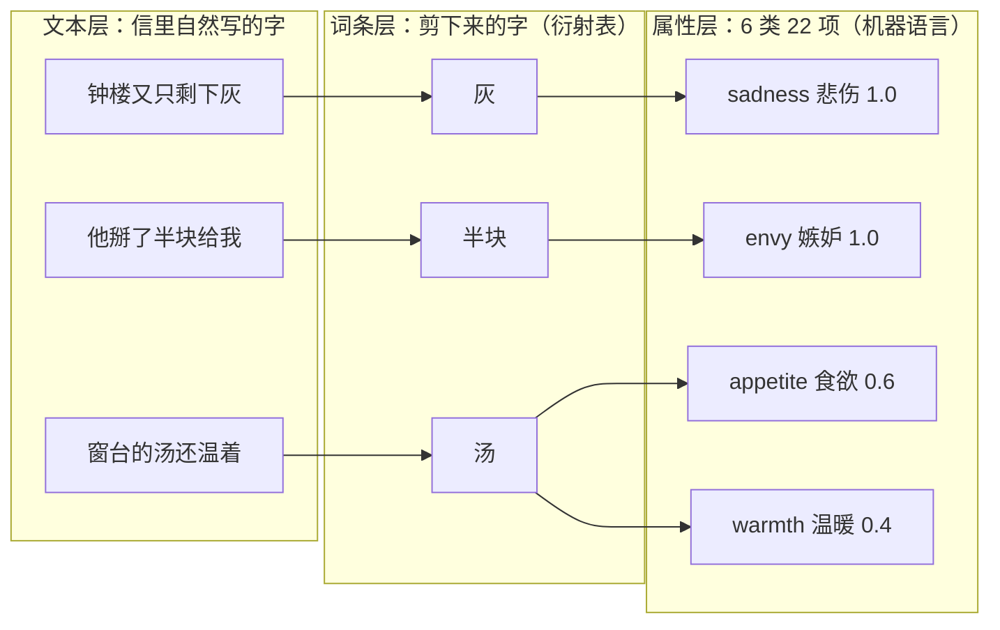
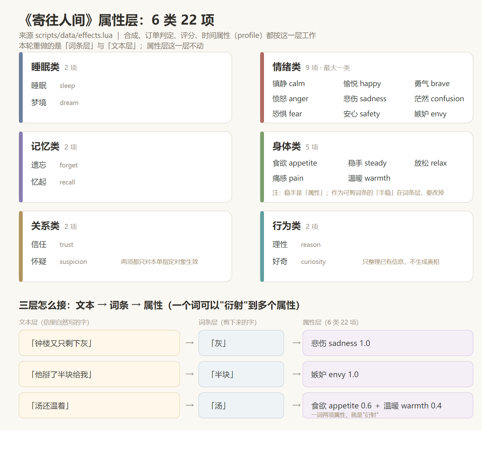

# 词条属性衍射表（提案 v01）

> 2026-10-03 · 组长提出：词条也要改——「手稳」是生造，「快乐 / 勇敢 / 难过」这一类应当是**属性**，不是正常人挂在嘴边的话；
> 建议先定属性种数，再写文本，最后在自然文本里找出可裁剪的词。
> 本文件是**提案，待拍板**；拍板后并入《文风基准与润色计划》的批次执行。
> 一句话结论：**属性层不动、词条层重做、两层之间用「衍射表」连接；一词可含多个属性；整个改动是纯内容改动，不需要改合成代码。**

## 1. 问题

现制把"效果标签"直接做成了可剪词：快乐、勇敢、难过、茫然、理性、放松、安心、信任、怀疑、嫉妒、好奇、温暖……
结果有三处别扭：

1. **不像人写的字。** 没人会在给魔药铺的信里写"我需要一点{{勇敢}}"。词被摆在句子的重音上，像填表。
2. **生造词。** 「手稳」既不是物件也不是动作，是描述，剪下来当词条很怪。
3. **两层混在一起。** 系统的"属性"（brave、happy、sadness）与人写下的"字"（面包、汤、旗子、井）被压成了一层，所以信不好写、词不好懂。

## 2. 设计：三层结构

```
文本层   信里自然出现的字面        「钟楼又只剩下灰」「他把一张旧图塞给赫达」
              ↓ 剪下来的是"字"
词条层   词条（衍射表右列）        「灰」→ sadness 1.0；「汤」→ appetite 0.6 + warmth 0.4
              ↓ 一个词条可含 1～3 个属性（就是"衍射"）
属性层   22 项机器属性（不动）      sleep / calm / happy / …（synthesis、判定、评分、profile 已按它工作）
```

- **属性层保持 22 项，分 6 类**（`effects.lua` 原样，不改代码）：



> 「汤」同时连到两项属性——这就是"衍射"：一个词带多个属性（现成例子：梦＝梦境＋睡眠、累＝镇静＋睡眠、回家＝忆起＋梦境）。

**22 项一览（2＋9＋2＋5＋2＋2）**：

| 类（项数） | 属性与中文名 | 人话理解 |
|---|---|---|
| 睡眠类（2） | sleep 睡眠 · dream 梦境 | 睡着 · 做梦 |
| 情绪类（9） | calm 镇静 · happy 愉悦 · brave 勇气 · anger 愤怒 · sadness 悲伤 · confusion 茫然 · fear 恐惧 · safety 安心 · envy 嫉妒 | 静下来 · 轻快 · 敢 · 怒 · 悲 · 乱 · 怕 · 安心 · 眼红 |
| 记忆类（2） | forget 遗忘 · recall 忆起 | 忘掉 · 想起来 |
| 身体类（5） | appetite 食欲 · steady 稳手 · relax 放松 · pain 痛感 · warmth 温暖 | 想吃 · 手不抖 · 松下来 · 疼 · 暖 |
| 关系类（2） | trust 信任 · suspicion 怀疑 | 信对方 · 防对方（都只对本单指定对象生效） |
| 行为类（2） | reason 理性 · curiosity 好奇 | 盘清楚 · 想打听 |

> 名称提示：**词条**「手稳」要改掉；**属性**里的「稳手」（steady）保留——一个在词条层，一个在属性层，别混。
> 这 22 项已在驱动合成权重累加、订单阈值比对、评分事实与时间属性（profile），**本轮不改**；要改的是左边的词条层与文本层。



> 同一张图另存为矢量版：[词条属性衍射表_附图.svg](词条属性衍射表_附图.svg)（可放大、可直接用浏览器打开）。

- **词条层规则**（本次新增，作为写作与改稿的硬规则）：
  - **R-1 自然字面**：词必须是写信人真会写下的字——具体物件、动作、身体状态。「面包」「汤」「井」「灰」「旗子」「零钱」「针脚」「榫」「哭」「嚷」「发呆」「歇」可以；「快乐」「勇敢」「难过」「理性」「放松」「安心」「茫然」「手稳」这一类（形容词化标签、生造描述）**不再作为词条**。
  - **R-2 一词 1～3 属性**：允许并鼓励多属性（"衍射"）。现成例子：梦 = dream 1.0 + sleep 0.4；累 = calm 0.6 + sleep 0.6；回家 = recall 0.6 + dream 0.4。
  - **R-3 权重档**：主轴 1.0；次要 0.4～0.6。同一属性的多来源权重可以不等。
  - **R-4 场景对应**：词从场景里长出来（面包坊出「面团」「零钱」，木作坊出「榫」「刨花」，钟楼出「灰」「钟」，洗衣巷出「皂」「盆」），不为了凑属性硬塞物件。
  - **R-5 每单主轴可达**：每张订单的三星主轴词，必须在"该单最早日之前"至少有两张未消耗卡可达（本信自剪的一张 + 先前订单的一张）。这是 T5 供应账的既有要求，换成具体词后照旧执行。

## 3. 衍射表（格式与草案）

格式：`词条（displayText）｜来源信｜属性 → 权重｜备注`。首单与前三单必须自足（首封信本身就能配出首单）。

**现有 30 词的处理草案**（"保留"=字面自然、照用；"退场"=字面换掉，属性由新字面承担）：

| 现词条 | 属性 | 处理 | 建议新字面（候选） |
|---|---|---|---|
| 睡觉 | sleep 1.0 | 保留 | —（首单核心，不动） |
| 梦 | dream 1.0 + sleep 0.4 | 保留 | — |
| 安静 | calm 1.0 | 保留 | — |
| 忘记 | forget 1.0 | 保留 | — |
| 累 | calm 0.6 + sleep 0.6 | 保留 | — |
| 饿 | appetite 1.0 | 保留 | — |
| 面包 | appetite 1.0 | 保留 | — |
| 答应 | recall 1.0 | 保留 | — |
| 抬头 | brave 1.0 | 保留 | — |
| 回家 | recall 0.6 + dream 0.4 | 保留 | — |
| 笑 | happy 1.0 | 保留 | — |
| 汤 | appetite 1.0 | 保留 | —（可顺带 +warmth 0.4） |
| 等 | calm 1.0 | 保留 | — |
| 疼 | pain 1.0 | 保留 | — |
| 温暖 | warmth 1.0 | 保留 | —（物理暖） |
| 快乐 | happy 1.0 | **已退场（2026-10-03 执行）** | 「笑」承担 happy。已落盘：首单 `body:2` 改「没个{{笑}}模样」、N04/N19/N22 同步换「笑」（N19/N22 各两处，正好补上「快乐」退役后的备用来源）、`word_happy` 删除、配方引用与见证/账目重算（`story-v0.4-r1`） |
| 勇敢 | brave 1.0 | **退场** | 「上前」或「开口」（N07 贝娅、M03 阿德琳场景各配一张） |
| 手稳 | steady 1.0 | **退场** | 按场景各配：面包坊「零钱」（N01）、木作「榫」（N06 莱昂修椅）、缝补「针脚」（艾丝特场景） |
| 生气 | anger 1.0 | **退场** | 「嚷」（N07 贝娅讨薪）或「拍桌」 |
| 难过 | sadness 1.0 | **退场** | 「灰」（N04 钟楼的灰）或「哭」 |
| 茫然 | confusion 1.0 | **退场** | 「发呆」或「发愣」（N10 雅各布） |
| 理性 | reason 1.0 | **退场** | 「清醒」或「算清」（N05 塞西莉亚、N09 阿涅丝核契据） |
| 放松 | relax 1.0 | **退场** | 「歇」或「松肩」（N08 马丁轮休） |
| 害怕 | fear 1.0 | **退场** | 「腿软」或「打颤」（N03 艾莉见陌生人） |
| 安心 | safety 1.0 | **退场** | 「踏实」（N03 艾莉） |
| 嫉妒 | envy 1.0 | **退场** | 「眼红」（N04 奥托）或「半块」（那块饼） |
| 好奇 | curiosity 1.0 | **退场** | 「打听」或「探头」（N11 艾莉、N03） |
| 想念 | recall 0.6 + dream 0.4 | 待定 | 动词，偏自然；可保留，或换「挂念」 |
| 信任 | trust 1.0 | 待定 | 「托付」（对象性：只对本单对象） |
| 怀疑 | suspicion 1.0 | 待定 | 「盘问」或「对账」 |

**词库规模**：仍是 30 个左右，不因换字面扩池；新字面替换旧字面，一进一出。

## 4. 覆盖与可达

- **全池覆盖 22 属性，不留空**：目前 steady / anger / sadness / confusion / reason / relax / fear / safety / trust / suspicion / envy / curiosity 都只有单一来源，趁换字面把它们补到每项来源 ≥2（"衍射"是最省的手段：一个具体词可以同时供两项）。
- **每单主轴**按 R-5 检查（两条可达路径）。
- **首单自足性**：首封信六个可剪位置改完后，必须仍能配出首单（sleep）与前三单的主轴；改完重跑既有账。
- **不改动的**：effects.lua、synthesis.lua、recipes.lua、equipment、订单要求与星级事实、profile 的机制（profile 挂在词条上，换字面时同步 `attributeProfileId` 引用即可）。

## 5. 流程（双向四步，回应组长提的顺序）

1. **定属性与覆盖**：22 项照旧；列出每项需要的来源数与订单可达要求（本文件的第 2、4 节）。
2. **写文本**：按《文风基准》写自然信；写的时候**预留意向可剪点**（第一次不再为词写句子，而是句子写完再看哪里能剪）。
3. **回填衍射表**：从文本里挑出可剪的字面，填属性与权重；同位置只剪一次、次序即 `body:N`。
4. **跑校验与账**：`check_delivery_content.py` + T5 的供应/漏单账重算；确认每单主轴两条路径、22 属性无缺口。

> 顺序说明：完全"先定表、再写文"会回到"为词写句"的老路；完全"先写文、再配属性"又可能配不出订单。
> 所以采用**双向**：先定属性覆盖需求（约束）→ 写文本时预留意向词 → 回填表 → 校验回环。

## 6. 影响面与批次

| 范围 | 改什么 |
|---|---|
| `scripts/data/words.lua` | 12～15 个词条的 displayText 与 effects；「信任→托付」「怀疑→盘问」已定，「想念」保留；`word_happy` 已退役（词池 30→29，2026-10-03） |
| 全部信件手稿 | `{{词}}` 标记与来源表（M/G/N 系列 + 首单）；随文风润色同批做（happy 整族已随 `story-v0.4-r1` 先行完成） |
| 首单运行配置 | `letters.lua` 首信 `body:2` 的「快乐→笑」**已完成**（2026-10-03）；`followup.lua` 不受影响（无词） |
| `ordinary_orders.lua` | N01/N02 的正文与标记（与手稿同步） |
| 三份验算 JSON / 逐日表 | 词卡供应、漏单词源、前三单组合需重算（脚本可重新导出） |
| 检查脚本 | `check_delivery_content.py` 的来源表与 expected marks；预算检查的留存见证（happy→smile）与前三单去重数（14→13）；单次性检查的冻结基线按批次前移 |
| 版本 | ~~递增为 `story-v0.4-r1`~~ **已递增为 `story-v0.4-r1`（2026-10-03）**，填写说明登记；存档 schema、synthesisVersion 不动 |

**执行顺序**：提案已定案（§7～§9）→ 定稿衍射表 → 与文风润色同批改稿（批次 A/C 优先）→ 回填与重算 → 检查与记录。批次划分见《文风基准与润色计划》§5。

## 7. 已定（2026-10-03 组长裁决）

1. **属性层固定为 6 类 22 项**，不再增删；以后若要扩属性，走版本化的规则变更（不建议，理由见 §8.4）。
2. **想念 / 信任 / 怀疑**：信任、怀疑**本就是属性**（关系类 2 项），保留；想念**不新增属性**，继续作为词条按 recall 0.6 + dream 0.4 承担（见 §8.4）。
3. **本图保持更新**：每次词条层变动（换字面、改权重、加删来源、属性可见性变化）都同步重画 SVG/PNG（维护方式见 §8.5）。

## 8. 设计问答（2026-10-03）

### 8.1 订单靠"属性数值门槛"分支——是的

每张订单有两层阈值，都按属性数值判定：

- **发货门槛（字面要求）**：主轴 ≥ 0.8、生效 ≤ 1 小时、持续 2～4 小时、sleep ≤ 0.4 之类——不过线不发货，没有回信、星级与奖励。
- **后续 / 星级分支（核心事实）**：同一单的 1 / 2 / 3 星各自绑定一组属性条件。以 N04 奥托为例：`envy ≥ 0.6 且 anger ≥ 0.6` → 一星；`envy ≥ 0.6` → 二星；`envy < 0.6` → 三星；M02 玛拉的三星则带 `calm < 2.2` 这类条件。

"不同后续 = 不同属性数值标准"成立，而且这正是"涌现"的落点：配方决定药效数值，数值决定落在哪条分支。

### 8.2 词条的属性数值，固定还是随订单变？——词条固定，订单变

- **词条的属性与权重是全局固定的**（世界法则）：「汤」永远是 appetite 0.6 + warmth 0.4，写给谁都一样。
- **炼制过程会变换数值**：八步求值里的辅助词权重、同标签奖励、强度缩放（灰烬草 ×1.5 之类）、副作用追加，都会改写最终值。
- **订单只负责读取**：每张订单按自己的门槛读取最终的属性值，所以同一锅药在 A 单可能三星、在 B 单只够一星。

词条不能"按订单改数值"：那会把可学习的规则变成"每单一套表"，玩家无法积累知识，"涌现"退化成"猜表"，也违背"魔药只理解文字"。

### 8.3 属性要不要藏起来？——建议：藏属性名与数值，留类别与锅里的见效

提案（待最终确认）：

| 层 | 给玩家看什么 | 理由 |
|---|---|---|
| 词条卡 / 库存 | 只显示字面与**类别**（身体、情绪、记忆…）；**不显示属性名与权重** | 保留"靠字面意思和理解加料"的核心体验；类别只帮整理，不直接给答案 |
| 炼制结果 | 照常显示效果名称、强度、持续时间（A6 的验收要求） | 第一次下锅才知道「灰」是悲伤——锅是唯一的老师 |
| 试错成本 | 预览与本单重置**不扣卡**（只有确认才消耗） | 藏而不坑：可以反复试看结果，只是要多花功夫 |
| 图鉴 / 档案桌 | 建议记"**已观察到**"的结果（用过一次后归档） | 让玩家的发现沉淀，不靠记忆或外挂笔记 |

配套小改：`words.lua` 现在的 `desc` 写的是"唤起食欲，不凭空烤出面包"这类**功能说明**，等于剧透属性；采纳隐藏方案时改成字面 / 风味描述（如「汤」＝"灶上留的那碗汤"），功能说明移到内部注释。

### 8.4 想念 / 信任 / 怀疑 的结论

- **信任、怀疑**：已是属性（关系类），不新增、不删——M03、N09、N10 等订单的关系轴靠它们；只把词条字面从「信任」「怀疑」换成动词（「托付」「盘问」）。
- **想念**：**不新增属性**。它由"词条 → 忆起 0.6 + 梦境 0.4"承担，机制够用；"想念"的惆怅属于文本层，不是判定轴。新增一个"思念"属性会牵动订单阈值、评分事实与时间 profile，收益极低。
- 结论：**22 项足够覆盖**，不再扩。

### 8.5 附图维护方式（保持更新）

- 源文件 `词条属性衍射表_附图.svg`（手写 SVG，文字可直接改）；渲染件 `词条属性衍射表_附图.png`。
- 任何词条层变动都同步重画，并随当批行动记录一起提交。
- 重画命令（本机实测可用）：

```
"C:/Program Files (x86)/Microsoft/Edge/Application/msedge.exe" --headless=new --disable-gpu --no-sandbox --hide-scrollbars \
  --user-data-dir="D:/To the Human World/.tmp/edge-profile" \
  --screenshot="D:/To the Human World/docs/文案/词条属性衍射表_附图.png" \
  --window-size=1040,1000 "file:///D:/To the Human World/.tmp/attr_chart.svg"
```

（先把 SVG 复制到无中文路径的 `.tmp/attr_chart.svg`；渲染后目视检查，再替换仓库里的 PNG。）

## 9. 定案结论（2026-10-03）

1. **首单同步**：同意改，但必须与 happy 整族同批（首信那张是唯一的备用快乐卡，单独换会被预算检查拦下）；执行落在批次 C 第一步，见《文风基准与润色计划》§5。
2. **属性隐藏**（§8.3）：**采纳"只标类别、不标属性名与数值"**的折中方案；`words.lua` 的 `desc` 改为字面/风味描述，功能说明移入内部注释；图鉴"已观察到"的记录作为小程序字段提案另交。
3. **执行分工**：按批次由内容侧改稿并回填衍射表（一文件一主改人不变）；重算账与跑检查随批进行。

本提案已定案，后续改动按 §5、§6 的批次与流程推进；每次词条层变动同步重画附图（§8.5）。
