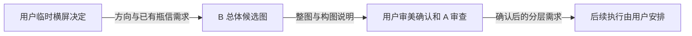

# 给创意窗口：横屏主页整图 v01

任务编号：B-HOME-LANDSCAPE-20261010，r1。用户统筹，A 整理需求，由用户转交 B。

## 可直接转发

我们暂时改成横屏了。等待手机测试资格期间，先帮我出一版《寄往人间》的横屏主页总体图。

这是我本轮确认的临时设计决定，不代表已经证实引擎只能横屏，也不代表手机发布已经通过。此前“尚未决定横屏”的说法已被这次决定替代；原来的竖版图和工程保留，后续如再变更方向会另行通知。

请先读下面的要求，核对参考图，然后生成一张完整横屏主页图，方便我判断整体构图。本轮先不批量抠图，不修改游戏或排版编辑器。

### 参考与氛围

- 以项目中的 `scripts/素材/主页效果_桌上四瓶与空白信件_v01.png` 为现有候选参考，结合我最新提供的工程预览。若我另附了更新的图，以新附件为准并记录版本，不默认你能看到其他窗口聊天。
- 保留“坐在海边魔药铺的工作桌前”的感觉：暖木室内、窗外雾蓝海面、安静薄雾，接近傍晚但还没有入夜，室内暖光与海面冷色稳定对比。
- 参考图主要提供空间、器物和功能关系，画风仍可讨论，不要当作全部细节都已定稿。希望自然、安静、有生活痕迹，减少为了装饰而堆物件的刻意感。

### 已确认要保留的内容

1. 漂流瓶放在窗前的桌面后沿，从左侧向窗中间排成一排，大小、高低和前后略有错落，能看出瓶里装着信。不要排成等距商品陈列，也不要悬空或挤满整个窗口。
2. 信件放在桌垫中间，是桌面的主要操作区域。纸面留白，方便以后叠加正文；要有足够阅读和操作空间。
3. 炼药锅、材料与纸张属于同一张工作桌，空间和透视要统一，不能遮住中央读信位置。
4. 不再做“点击抽屉—拉开—里面放瓶和信”的方案。瓶和信就在桌上；桌柜本身可以作为固定家具保留。

### 本轮构图建议（可以提出更好的方案）

- 先按 16:9 横版试稿，建议 1920×1080。比例和像素尺寸只用于这一版构图，不是引擎分辨率要求。
- 建议中部保留宽阔桌垫和信件，瓶排在窗前偏左，炼药区在右侧；窗外海景仍要有存在感，但别挤得桌面操作区太小。
- 日历、剪刀、词条托盘、配方书、钱袋和捞网作为次级物件安排，不要为了塞进所有装饰把桌面铺满。若建议隐藏或调整某个功能入口，请说明，不自行删掉功能。
- 参考图中的四个瓶子可以先沿用，数量不是冻结规格。别简单拉宽竖图或裁掉上下两块，要重新组织横屏视角、物件尺度与留白。
- 重要物件尽量放在画面内部，边缘以可裁切的背景为主；这只是构图预留，不能代替手机安全区验证。

### 为后续分层留条件

先看整图，确认方向后再另行安排提取漂流瓶排和中央信件。整图里让这两组物件的轮廓清楚，少被其他器物交叉遮挡，接触阴影范围尽量局部，避免和桌面装饰糊成一片。整图生成完成不等于透明素材已交付。

### 交付

- 一张完整横屏主页候选 PNG，建议文件名 `主页效果_横屏工作台_v01.png`，保存到 `D:/taptap/To-the-Human-World/scripts/素材/`；不覆盖旧竖版图或既有素材。
- 附简短说明：实际参考文件/版本、实际输出尺寸、相对竖版的主要构图调整、以后哪些内容建议独立分层。保留生成时实际使用的提示词。
- 我先确认整体感觉；A 检查是否符合这次约束。后续是否抠图、调整画风、接入编辑器和游戏，再单独安排。

## 任务归属与完成条件

| 项目 | 内容 |
|---|---|
| 接收窗口 | B 创意窗口，用户转发 |
| 上游依据及版本 | 2026-10-10 用户“暂时改成横屏”决定；方向口径 r2；桌上四瓶与空白信件候选 v01，SHA-256 `b278254c16ea77b1fd3d62095fae26d4daee54ee1a0f8b3f8cb6b28e637c657d` |
| 目标与范围 | 一版横屏主页总体候选图及构图说明；不扩大到全部页面、美术重制或代码实现 |
| 可修改文件 | 在 `scripts/素材/` 新增本任务候选图/必要过程图；新增本任务制作行动记录；既有素材、设计规范、代码与编辑器数据不覆盖 |
| 保存位置 | 图片：`scripts/素材/`；制作记录建议：`docs/actions/2026-10-10-b-landscape-home.md`，若同名已存在先核对归属 |
| 验收方法 | 打开实际 PNG 检查横屏尺寸、透视、瓶排/信件/炼药区的可辨识性与遮挡；区分用户约束和本稿建议；不能拿整图证明分层、交互或发布已通过 |
| 下游接收者 | 用户确认审美，A 独立审查；C 后续执行由用户安排 |
| 未决事项 | 最终画风、最终比例与裁切规则、瓶子数量、精确位置及热区、后续抠图与动态层方案 |
| 替代关系 | 当前主页试稿按横屏执行；旧竖版构图不再约束本轮整图。旧图保留作参考，其历史质量结论不因换方向作废 |

