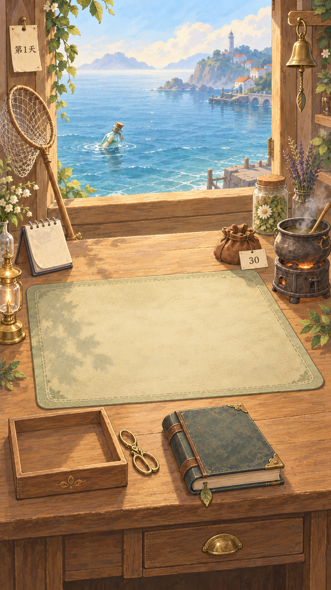

# 主页总体原型与分层说明 v0.1

> 后续修订见 [v0.2：日历、金剪刀与雾蓝海面](主页原型与分层说明_v02.md)。用户选择的是最初生成的第一图作为底稿；本页所示第二轮图保留为历史方案，后续制作以 v0.2 的选择与反馈为准。

> 日期：2026-10-05；代码基线：207f5c6。用户已选择温暖手绘绘本作为讨论方向；本图为布局与风格提案，未获最终视觉定稿。
> 对应接口：[前端接入接口手册](../../scripts/前端接入接口手册.md)。本轮未修改运行 UI、业务配置或存档。



## 1. 本图是什么状态

- 示意新档刚进入经营主页：海面上有一只待打捞漂流瓶；桌面没有收到的瓶子、没有打开的信件；词条托盘为空。
- 中央信纸大小的浅色区域是**空书写垫，不是信件正文**。收到并打开信件后，在这里叠加真正的信纸与动态正文。
- 天数“第1天”、金币“30”仅用于表现当前初始配置；正式界面必须使用文本控件读取状态，不使用图中烘焙的文字。
- 旧档进入时依照保存状态显示；若有 pending，应引导回待确认后续，不强行回到空主页。
- 日历用作“结束当天”的入口、铃铛用作设置，是本图的交互提案。原型未创建对应设置功能。
- 配方书是后续功能的空间预留，不能把原型中有书理解为配方发现/解锁系统已完成。第一批可作静态陈设，或明确未接入。
- 远景建筑只是氛围插画，不代表玩家可外出，也不定义新的剧情地点或可调查地点。
- 炉火与轻蒸汽可作待机气氛；真正“正在炼药”的反馈要与操作状态区分，不应误导玩家开局已经制作药水。

## 2. 视觉与构图

- 保留木屋、蓝色海面、暖光、纸张、玻璃和黄铜；统一手绘笔触。
- 上部海景负责氛围和打捞；中间空书写垫是信件落点；右侧炼药；下部托盘、剪刀、书和抽屉。
- 本图按竖版 9:16 构图生成，实际为 941×1672 RGB PNG，接近该比例；不是已经完成 1080×1920 安全区适配的运行截图。
- 第二轮减少纹理细节、移除前景椅子、完整露出托盘和抽屉。炼药锅/搅拌杆仍较靠右，正式布局应继续内移并按真实安全区核对触摸范围。
- 海景占比、书写垫质感、锅的位置、配方书是否成为首期入口均可讨论；不据一张生成图冻结位置。
- 正式信件视图可以从主页放大到独立阅读状态；不要把几百字正文缩在主页书写垫上。

## 3. 原则：按变化和交互拆层，不按所有可见物体拆层

需要独立的条件：会显示/隐藏、被拖动、需要换状态、要播放动画、会升级替换、需要独立深度遮挡。

固定且不交互的墙面、木纹、静止花草、远景建筑可以合并。若以后要做摇曳动画，再从背景里拆出对应枝叶；第一版无需每片叶子一个文件。

可点击区域是引擎中的透明热区，不必为每个热区再出一张可见图片。文字和数字由 UI 控件显示，不能按每个数值导出图片。

## 4. 建议图层顺序与素材清单

下表是制作建议，**不是已导出的素材列表**。本轮仅交总体 PNG；透明物件和干净底图尚未生成。

| 顺序 | 图层/素材 | 是否必拆 | 状态与原因 |
|---|---|---|---|
| 00 | 天空、远岛、建筑剪影 | 可合并为远景层 | 固定气氛；无昼夜切换 |
| 10 | 干净海面，不含瓶子 | 建议独立 | 轻微流动或静态都可；瓶子消失后不能留下瓶影 |
| 20 | 瓶子后方水纹 | 需要动画时独立 | 水中浮动，不跟桌面物件共用 |
| 30 | 海上瓶子，每种外形一个素材 | 必拆 | 按可打捞列表出现；同图可多实例，不需要画若干固定数量背景 |
| 40 | 瓶子前方水纹/水线遮罩 | 建议独立 | 让瓶底浸入水中，而非贴在海面上 |
| 50 | 窗框、墙面、窗台与固定装饰 | 合并成前景结构层 | 窗洞需透明，以叠在海面前遮挡；固定挂草可合并 |
| 60 | 干净桌面、桌体、书写垫、固定灯与装饰 | 第一版可合并 | 不含活动工具、文字、信件；必须补全物件下方区域 |
| 70 | 日历/日历翻页 | 建议独立 | 结束当天的点击反馈；无需把昼夜变化画进背景 |
| 70 | 钱袋与空白纸签 | 建议独立 | 钱袋可整体轻动；金币为更上层动态文字 |
| 70 | 炼药锅与炉座 | 必拆 | 未来设备替换、操作反馈；锅/炉可以先合为一个可替换组 |
| 71 | 炉火、液面、气泡、蒸汽 | 分离特效 | 动画及药效反馈；蒸汽不能烘焙在锅的边缘里 |
| 70 | 空词条托盘 | 必拆 | 内部叠加卡片，移入/移出时保持底板完整 |
| 71 | 托盘前沿遮挡 | 需要入盒动画时独立 | 卡片落入后可部分被前沿遮住 |
| 70 | 剪刀 | 必拆 | 移动/剪切反馈；正式动画可用整体帧序列，或两片刀身绕铆钉转动 |
| 70 | 配方书 | 建议独立 | 点击/开合；封面、打开书页是不同状态，不靠拉伸同图 |
| 70 | 抽屉正面与把手 | 必拆 | 打开/关闭状态切换；桌体留洞与内部，不能只挪走一块木纹 |
| 70 | 铃铛 | 需要互动时独立 | 点击摇动；可暂静态保留 |
| 80 | 已收未开瓶 | 必拆，当前原型未出现 | Receive 成功后显示；桌面姿态需另画，不能直接复用水中瓶连水纹 |
| 90 | 展开信纸/信纸堆 | 必拆，当前原型未出现 | 已读/选中状态；空白纸张与正文分开 |
| 91 | 信件正文、心愿强调、地址 | UI 动态文字 | 排版、滚动、字体与可剪标记分别处理 |
| 92 | 剪词缺口与纸边 | 遮罩/组件或少量通用素材 | 依 span 状态定位；不能按某一封信把所有缺口画死 |
| 100 | 词卡纸片 | 必拆，当前原型未出现 | 空白纸片加动态字面；从信纸到托盘再到炼药区 |
| 100 | 待决定结果提示/药瓶表现 | 后续独立制作 | 映射 pending；不擅自形成新的药水库存系统 |
| 110 | 数量、天数、金币、提示与可点击状态 | UI 控件 | 数值读取正式状态；不烘焙文字，不单凭颜色表示禁用 |
| 120 | 放大阅读、抽屉详情、后续决定等面板 | 单独视图 | 覆盖主页，关闭只改变显示，不自行确认/重置 |

同一层号表示默认深度组，具体物件需要按遮挡关系排序。素材有透明边距时，热区应贴合实际可见物件并适当扩大，不直接使用整张透明画布作为点击区。

## 5. 不必立即分割的元素

- 远处灯塔、房屋、天空与岛屿：可同一远景图。
- 不动的墙板、窗框细节、螺钉和金属合页：可同一结构图。
- 桌面木纹、静态桌垫、固定装饰植物：可同一桌面底图。
- 炼药区不参与库存选择的装饰草药瓶：可以放在固定装饰组，但不得混淆为可拖材料。
- 灯如果只作为静物可以留底图；需要火焰闪动时只拆火光，不必拆每个灯罩零件。

## 6. 状态如何控制叠加

| 情景 | 海面 | 桌面工作区 | 托盘/订单 |
|---|---|---|---|
| 新档 | 显示当前可打捞瓶子 | 空书写垫 | 空托盘，无当前单 |
| 收取成功，未读 | 对应海上候选不再显示 | 叠加已收到的未开瓶 | 尚未产生词卡 |
| 阅读成功 | 其他瓶按查询显示 | 未开瓶转为展开信件 | 仍以库存查询为准 |
| 剪词成功 | 不受动画影响 | 指定位置显示缺口 | 对应来源卡出现一次 |
| 第一次投料 | 可保留海上瓶但禁止当前打捞 | 可只读查看已读信 | 试用选料，正式库存未扣除 |
| pending | 根据门禁关闭收取 | 显示待决定提示/引导到后续页 | 不提前到账、不提前永久消耗 |
| 确认成功 | 重新查询可用内容 | 当前单移入已确认展示 | 更新正式金币和可用词卡 |
| 重置成功 | 仍受 brewing 门禁 | 保留基准前缺口 | 返回首次投料基准，重试 |
| 查询或保存异常 | 保留可信状态 | 显示提示/恢复入口 | 不用“空物件”掩盖错误 |

在表现动画与业务提交之间，Receive/Read/Cut/Confirm 的返回值是准绳。动画结束不等于业务成功；失败时恢复到最后可信视图。每个动作只发一次命令，不能在点击、动画完成、页面切换三个回调里各执行一次。

## 7. 正式素材制作方法

1. 先讨论并确认总体构图，然后按清单制作**干净底图**和**独立透明物件**。
2. 干净底图必须绘出原先被锅、书、托盘遮挡的桌面；仅从成图抠走物件会留下空洞，不能直接作为背景。
3. 玻璃瓶需要透明玻璃表现，阴影/水纹最好独立；直接抠图会把旧海面一起带走，要重制或修复。
4. 活动物件保持统一透视、尺度、光源方向。物件接触阴影独立或随物件移动，不能留在底图上。
5. 保存锚点、建议尺寸、层级、交互热区、普通/选中/禁用/打开状态；建议统一以1080×1920逻辑画布标注，再由引擎按比例和安全区适配。
6. 数字、天数、信件、词卡和价格必须由文本控件生成；图上文字只是原型展示。
7. 正式资源进入项目既有 Maker 资源流程（如 assets/image），保留映射。当前 docs 原型仅供设计讨论，不冒充运行资源。
8. 本轮不直接从原型批量切出“可交付精灵”；不需要每一个静物都独立导出。

## 8. 生成与检查记录

- 使用内置 image_gen，不使用 CLI/API fallback。
- 第一版出现托盘、炼药区靠边裁切与前景椅子遮挡；第二轮简化纹理并改善布局。
- 第二轮作为本次讨论稿，文件为 [home-storybook-v01.png](原型/home-storybook-v01.png)。
- 已目视核对无桌面信件/词卡、空工作区、一个海上瓶、天数与金币；未进行引擎或手机视觉验收。锅边距仍待正式布局细化。
- 这张 PNG 没有可编辑分层；本文是下一步拆层制作规范。

### 原始生成提示词

```text
Use case: ui-mockup.
Asset type: one full-screen portrait 9:16 mobile narrative crafting game homepage concept, approximately 1080x1920 composition, no phone frame, no panels of multiple screenshots.
Primary request: Create the first-entry home/workbench screen for the Chinese game 《寄往人间》, a quiet timeless seaside potion shop. This is a cohesive full visual prototype for discussion, not a cutout sheet.
Style: warm hand-painted storybook illustration, soft gouache and watercolor, restrained pencil outlines, simplified broad shapes, gentle handmade materials. Charming and polished but not photorealistic, not 3D, not pixel art. Clear readable objects on a small phone screen. Reduce texture noise and decorative clutter.
Composition: camera is a unified slightly elevated view from inside a wooden seaside shop. Upper 35 percent: broad open wooden window overlooking calm mist-blue sea and soft distant island silhouettes, timeless warm light, no dramatic sun disk. Middle and lower 60 percent: generous close wooden workbench, its perspective compatible with the window. The primary center-left focal work zone is a large EMPTY muted warm cream/soft sage leather writing mat, no letter or text on it yet; sufficient clean space for a future large letter overlay. Make the table occupy more space than the scenery.
Interactive objects: ONE clearly visible corked glass message bottle floating on near water toward left center of the window, large enough to tap. A long-handled scoop net leaning at the left window edge with its handle reachable near the table. On the right side of the table a modest small old round potion cauldron on a compact stove, faint soft steam, a couple of simple herb jars behind it. Lower left an EMPTY shallow wooden word-card tray, with a small pair of brass scissors next to it, no word cards yet. Bottom center a CLOSED thick leather recipe book, leaf bookmark, no lettering on cover. Bottom-right table fascia has a closed wooden drawer with a brass pull, readable silhouette. Small coin pouch resting near upper-right table edge, with a small separate cream paper label displaying only “30”. Upper-left window post has a modest paper day tag displaying only “第1天”. A tiny desk calendar with a turned paper corner near the left edge serves as a future end-day object, leave it unlettered. A small unlit hanging brass bell on the right frame suggests settings. Keep each functional object separated enough to recognize and later recreate as layers; do not cover the central writing mat with objects.
State: TRUE NEW-GAME STATE for this mockup: one bottle still at sea, NO received bottle on table, NO open letter, NO envelope, NO word cards, NO finished potion, NO result ribbon, NO visiting merchant boat. It should feel inviting and alive rather than empty, with plenty of clean room for upcoming states.
Palette/material: cool muted blue/teal sea, warm honey-brown aged wood, soft ivory paper, antique brass, muted sage herb accents; light consistent from upper-left, subtle soft contact shadows, pale warm ambient light. Fine texture only at object edges, no heavy dirty paper.
UI principles: functions embodied by objects, no bottom navigation bar, no modern rectangular buttons, no floating neon icons, no RPG HUD, no captions or leader lines. Safe uncluttered inset top/bottom; objects and labels away from extreme edges. No human or pet character. Only text allowed is exact “第1天” and “30”, discreet and crisp; NO other text, title, watermark, or logo. Finished beautiful game screenshot-like concept with unified art direction.
```

### 第二轮修改提示词

```text
Use case: precise-object-edit / ui-mockup. Edit the supplied first-entry homepage concept for 《寄往人间》.
Keep the portrait 9:16 composition, calm seaside wooden shop, warm storybook palette, ONE corked bottle at sea, empty central writing mat, empty word tray, scissors, closed recipe book, small coin pouch with “30”, day tag “第1天”, calendar and bell. No letter, envelope, word cards, merchant or character.
Specific correction: all functional objects must be entirely inside the visible screen with comfortable tapping margin. Move the cauldron/stove noticeably left and slightly reduce its size so its complete right silhouette, handle and base are visible with a 5 percent screen margin; do not clip it. Move the EMPTY word tray right slightly and reduce it modestly so its left and bottom edges are fully visible with 5 percent margin. Keep scissors beside it. Keep the book and lower drawer pull fully visible and reachable. Remove the foreground chair because it blocks the desk fascia and drawer. Remove the extra cropped book at the extreme right and the unnecessary mortar clutter. Keep the main empty writing area generous.
Style correction: make the illustration more obviously warm hand-painted storybook gouache, simplify dense wood grain and jar details, use broad softly painted shapes and restrained pencil contours. Retain material identity and gentle spatial depth, not a photographic render. Do not add new functional props or change business state. Preserve lighting from upper-left and mist-blue sea; no additional text beyond existing “第1天” and “30”. This is a polished gameplay homepage concept, not a annotated sheet.
```
