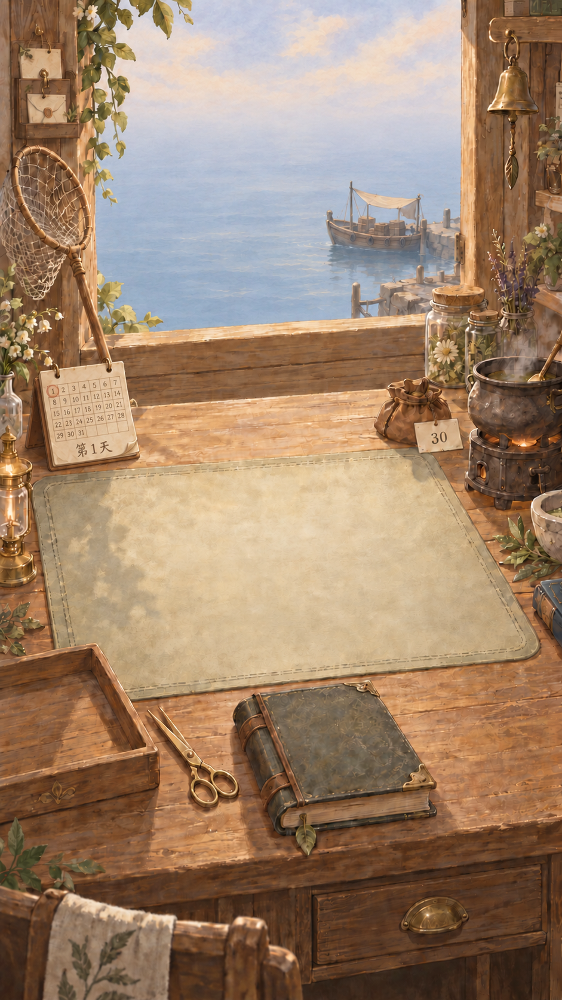
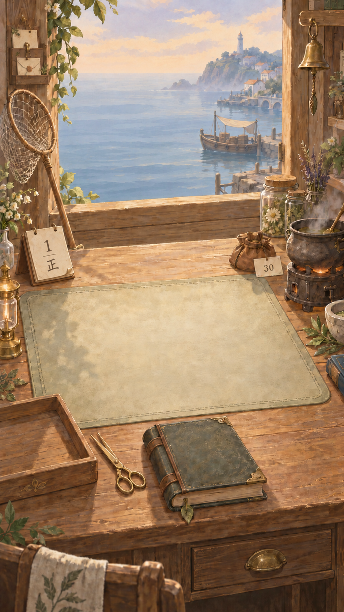
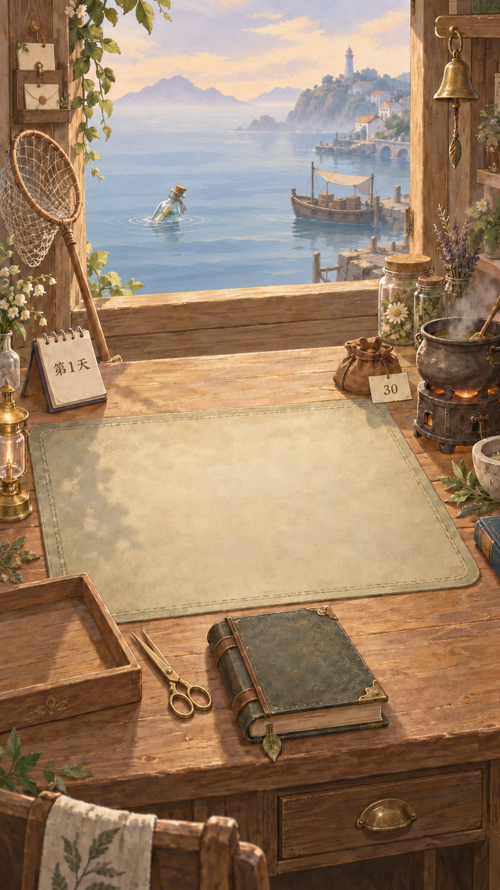

# 主页原型与分层说明 v0.2：日历、金剪刀与雾蓝海面

## 最新视觉修订 v0.4（2026-10-05）



- 桌左月历为手绘七列日期格，圈出 1，下方显示“第1天”，纸页、装订与卷角融入场景。当前请求采用天数标记，替代 v0.3 的正字表现；不新增真实年月规则。
- 无漂流瓶；远处山岸、村落与灯塔移除，海天通过雾蓝薄雾柔和融合。近处商船和栈台保留。
- 月历纸页、日期数字、当天圈记与“第几天”正式制作时分层；此图仍是整体概念图。漂流瓶后续按实际可打捞状态叠加，本次空海面不代表删除打捞功能。
- 内置图像编辑完成；完整提示词及检查见[本轮行动记录](../actions/2026-10-05-home-monthly-calendar-open-sea.md)。

## 历史视觉修订 v0.3（2026-10-05）



- 日历换为双环装订、叠纸与卷角的小纸质台历，上方日期“1”，下方手写“正”字计时。
- 移除海上漂流瓶及其专属水纹，移除左侧和中央远山，露出雾蓝海平线；右侧近岸村落、灯塔、码头与商船保留。
- “正”字仅为计时表现示意，每笔与游戏时间的对应关系尚未定义；本图无瓶表示此版本的空海面构图，不删除游戏打捞功能。正式接入仍将瓶、日期与计时笔画作为独立状态层。
- 原 v0.2 图片和下文历史说明保留；此次变化与完整提示词见[修订记录](../actions/2026-10-05-home-natural-calendar-revision.md)。

## v0.2 历史说明

> 2026-10-05。用户选中的是第一轮生成图（exec-c7bc935b…），不是 v0.1 文档展示的第二轮图。本轮从用户选中的第一图修改，保留原构图和前景椅子。
> 状态：待用户视觉反馈的概念修订稿，未接入引擎；本轮未修改 Lua、data 或存档。
> 接口基线仍见[前端接入接口手册](../../scripts/前端接入接口手册.md)。



用户选定的原底稿保存在[第一图底稿](原型/home-storybook-v02-selected-base.png)。旧版与本稿分别保留，不覆盖用户选图。

## 1. 已落实的修改

1. 取消左窗柱悬挂的“第1天”纸签；桌面左上方原本空白的小本子改作台历，在日历上显示“第1天”。正式文字仍由 UI 绘制。
2. 剪刀替换为金色普通剪刀：两个指环、中间铆钉、两片直而尖的刀刃，微张开；不再是圆弧/环形刀片。
3. 海面使用较大块的雾蓝、灰蓝横向笔触，减少碎浪白线与密集反光；远处海岸用薄雾柔化。
4. 天空偏奶油色、浅桃色和淡灰紫，维持接近傍晚但仍明亮的恒定氛围；无日落圆盘、无星月。室内木色与灯光保持暖色，海面保持冷色。
5. 左窗柱释放出的空间放小型木制档案架；右侧水面靠码头补海上商人的篷船，供功能入口讨论。
6. 保留用户喜欢的第一版工作台、书写垫、前景椅子、托盘、书、锅、钱袋与铃铛位置。未把上轮移除椅子的方案当成用户决定。

## 2. 每个物件去哪个页面、做什么

下表是 UI 交互设计映射。标为“后续”的功能不是当前运行代码已完成的接口。

| 物件/位置 | 进入页面或局部操作 | 功能与状态依据 |
|---|---|---|
| 左侧长柄捞网、窗外近海漂流瓶 | 打捞视图 | 根据 FindAvailable 显示候选；Receive 成功后变成桌上已收瓶 |
| 桌面上的已收未开瓶（本稿未画） | 开瓶演出→读信页 | 使用已收到实例；Read 成功才切为已读信纸 |
| 中央工作垫上叠加的信纸（本稿未画） | 放大读信页 | 自介、正文、署名/地址的阅读；新版强调/署名持久字段仍需接入。空垫本身不生成信件 |
| 金色剪刀 | 当前信件的剪词操作 | 不是单独页面；先有可读且允许剪裁的信，按 spanId 请求 CutWord |
| 左下词条托盘 | 词卡抽屉/选择视图 | 看字面、类别、来源与可用张数；炼药时选择具体 tokenId |
| 右侧炼药锅 | 炼药页 | 投料、移出、试配、药效与失败原因；合规后进入直接后续 |
| 下方厚皮书 | 配方书页（后续） | 已知配方/材料说明/组合记录的设计入口；现无完整发现/记录系统 |
| 桌前抽屉/把手 | 库存抽屉 | 材料、词卡与物品；当前先接已有材料和词卡数据 |
| 桌边钱袋 | 主页余额显示，未要求独立金币页 | 读取正式 currency；候选报酬不提前算到账 |
| 桌左上方日历 | 天数显示；建议点击展开“结束当天”操作 | 只更新日期文本；是否可跨天从 NextDay 门禁读取，不变成昼夜系统 |
| 右上铃铛 | 设置浮层（具体项目待实现） | 后续音量等；不同时兼任商店，避免同物件职责混淆 |
| 窗外右侧篷船 | 海上商店页（后续） | 仅到访/开放时作为有效入口；当前 Shop 未实现 |
| 左窗柱木制档案架 | 信件档案桌页（后续） | 整理已收到的人物、地址、信件与后续，不泄露未收到线索 |
| 炼药锅、捞网等设施本身 | 升级详情（后续交互提案） | 建议在相应功能页内设升级入口，或长按设施；不把普通单击同时绑定两个动作 |

### 不需要新增常驻主页物件的流程

- 直接后续、星级与“确认/重置”由炼药成功的 pending 流程进入，复用信纸视觉。
- 保存失败与恢复使用提示/浮层；不是再摆一个“存档道具”。
- 设施升级依托真实设施；主页不增加现代底部升级导航栏。
- 已确认历史可以先在现有后续视图重读，完整档案页另行开发；不能把简单历史重读写成档案系统已完成。

## 3. 本稿显示的是功能构图示例，不是已实现的开局状态截图

本稿保留空工作垫、空词条托盘，并加入商船以讨论它的位置，属于**商船到访时的视觉示意**。当前代码没有商店到访状态，不能据图认定第1天必定出现商船。

- 真正新档：按内容查询显示可打捞瓶；已收瓶/信纸/词卡由实际状态决定。
- 商船：后续接到访规则后显示或隐藏；未接入前不能点击后假装购买成功。
- 档案架上的纸片为造型占位，不对应玩家已拥有的线索；运行中按已收到内容显示空/有档案。
- 金钱纸签“30”来自当前开局配置的示意，正式界面为动态文字。
- 日期仍只在桌上日历显示。跨天只改天数与业务，不令海景变夜景。
- 炼药锅待机蒸汽只作环境氛围，不表示正在执行一次订单。

## 4. 分层制作相对 v0.1 的变化

基础拆层原则继续沿用[v0.1 分层清单](主页原型与分层说明_v01.md)，但采用本稿的新位置与造型：

| 素材 | 本轮增量 |
|---|---|
| 天数纸签 | 删除独立悬挂日期物件；日期文字改叠在桌上日历 |
| 日历 | 单独底座/纸页，日期由 UI 绘制；翻页演出与成功跨天同步 |
| 金剪刀 | 重新制作正常直刀片素材；可整体帧动画，或分两半绕铆钉转动 |
| 雾蓝海面 | 重画干净海面层，不能残留瓶子、商船、水影；动画保持慢、幅度小 |
| 商船 | 独立透明船体与柔和水影/水纹；到访显示、离开隐藏，不烘焙进海面 |
| 档案架 | 架体与纸卡可分层；空架为初始可用造型，纸卡按内容叠加 |
| 前景椅子 | 保留原图；若未来遮挡抽屉操作，可讨论调整，当前不擅自移除 |
| 中央信纸与词条 | 仍为后续动态层，不能把空书写垫误当正文信纸 |

需补画被物件遮住的干净底图，不能只从平面图抠走物件。当前 PNG 是不透明总体概念图，尚未切出透明素材。桌左托盘和右锅仍有靠边构图，手机安全区与放大热区须在正式实现时核对。

## 5. 手绘海面的参考检索

用户要求寻找绘画海面参考，本轮使用网络图片搜索，检索到下列作品页面：

- [Bet Low：Coast in Mist](https://www.franklinbrowns.co.uk/catalogue/lot/67ccef275ae7c307a55d739960b5dbec/120c74f2d99c26ad747b2640bb0cc6e9/paintings-prints-lot-30/)：检索结果介绍为柔和蓝灰层次与薄雾的水粉海岸。
- [Robin Lachman Lee：Horizons](https://wontree.art/horizon-series)：检索结果包含柔和水彩海平线与蓝色水面、暖色天空方向。
- [Lisk Feng：When Marnie Was There](https://liskfeng.com/when)：检索结果呈现绘本水面、暮色与纹理笔触方向；其中夜色/星空不属于本项目需求。
- [Lili Wood：Bain d'Hiver 6](https://www.slowgalerie.com/en/liliwood/16628-bain-d-hiver-6-exclusive-artwork.html)：检索结果介绍为粉蓝和轻柔色彩的海景绘画。

限制：尝试打开部分原图/作品页时返回 Cache miss 或超时，未完成这些原图的独立视觉核验。以上作为搜索发现记录，不声称已逐张检查原图，也没有下载、复制或作为 imagegen 输入。实际编辑只使用用户自己的第一版原型，并以原创描述指定手绘色块、薄雾、低对比和恒定傍晚；不要求复刻任何作者的具体作品。

## 6. 本轮检查与边界

- 已用正确的 C:\\Users\\YINGYI 路径读到附件所指第一图；无需用户重新上传。
- 内置 image_gen 第一轮完成日历、剪刀与入口增补；第二轮只强化海面概括笔触、减少细波纹。
- 最终图目视可见桌上“第1天”、窗柱档案架、正常金色直剪刀、商船与更平静的雾蓝水面。保留室内暖光与原构图。
- 无 Lua/data 变更，无引擎/手机验收，无提交或推送。
- 原前端草案和案件稿的用户修改保持原样。具体验证见[行动记录](../actions/2026-10-05-home-calendar-misty-sea-revision.md)。

## 7. 完整生成提示词（内置 image_gen）

### 第一轮：从用户选中的原图修改

```text
Use case: precise-object-edit.
Edit target: the supplied FIRST homepage concept image selected by the user. Preserve its original portrait framing, wooden shop architecture, large clear desk writing mat, camera perspective, foreground chair, empty tray, leather book, drawer, cauldron, herbs, coin pouch, window and bell. User likes this exact original, do NOT replace it with a redesigned room. Produce one full-screen portrait game homepage concept, no annotations or comparison grid.
Required changes:
1. REMOVE the paper day tag from the upper-left wooden window post completely and repair the wood behind it. Use the EXISTING small blank spiral-bound standing notebook on the DESK UPPER-LEFT as a desk calendar: cream paper page, clearly and elegantly write the exact Chinese “第1天” on that page, centered. This is the only day indicator; no duplicate hanging day tag.
2. Replace the odd scissors beside the tray with NORMAL functional GOLDEN STRAIGHT-BLADED SCISSORS. Two recognizable finger loops at one end, one central pivot screw, and TWO LONG STRAIGHT TAPERED POINTED BLADES at the other end. Slightly open in a narrow V, pointed tips directed toward upper-left so their shape is readable. Blades must be straight and noticeably longer than the pivot, not round, not loop-shaped, not curled, not ornamental. Retain warm antique-gold metal and appropriate scale.
3. Repaint the entire SEA AND SKY to strongly evoke handcrafted warm storybook watercolor/gouache. Sea is muted FOG BLUE, soft blue-gray and gray-teal, calm, quiet, slightly misty. Use broad gently irregular horizontal painted bands and a few restrained pale ripple strokes, visible soft brush edges, matte pigment. Eliminate the photographic fine ripples, sharp glitter and hundreds of white wavelets. Haze softens distant coast/islands and architecture. Sky pale cream, faint dusty peach and soft lavender-gray near the horizon: an eternal late afternoon approaching evening, STILL LIGHT, never night, no visible sunset sun disk, no moon, no stars. Keep outdoor water cool; warm amber indoor wood and lantern glow form a stable gentle contrast. Do not turn the entire picture orange. Keep room detailed in the original hand-painted style but coordinate light subtly so it is not harsh noon sunlight.
4. Functional additions within existing scene: add a SMALL but recognizable wooden sea-merchant boat with a simple muted tan canvas canopy and a few cargo crates floating near the right-hand pier in the window, separate from the bottle. It should be an inviting shop entrance prop, not a large ship, not a human character. Add a COMPACT wooden letter archive rack/soft noticeboard on the upper-left wooden window post in the area freed by the removed day tag; a couple of cream file cards held by brass clips, small paper tabs, no readable text, no red detective string. It must look like private correspondence storage, clearly distinct from the calendar on the desk. Keep view of the sea spacious.
5. Keep the single corked message bottle floating left of center in the sea. Keep table writing mat EMPTY, no delivered letter, no word cards. Keep coin label “30” and right hanging bell. Do not add a separate modern upgrades button: actual cauldron/net/furniture serve as future upgrade targets.
Constraints: preserve all other composition and atmosphere the user selected, including the foreground chair and main object positions. The result is a warm handmade fairy-tale game UI concept, not a photograph. Do not add modern nav bar, HUD icons, title/logo, text labels or explanatory arrows. Only readable text should be “第1天” ON THE DESK CALENDAR and “30” on the existing coin tag. Maintain portrait aspect ratio.
```

### 第二轮：只简化海面与远景

```text
Use case: precise-object-edit. This is a very localized repaint of the supplied portrait game homepage.
Preserve EVERY indoor object, the entire wooden room, desk, writing mat, foreground chair, left archive rack, calendar text 第1天, GOLD STRAIGHT-BLADED scissors, cauldron, empty tray, coin pouch label 30, leather book, drawer and hanging bell EXACTLY as in the supplied image. Preserve all their positions and sizes. Preserve the bottle at left and merchant boat at right.
Change ONLY the WATER/SKY/DISTANT COAST inside the open window, especially the sea surface. Current water remains far too realistic and covered in fine choppy wavelets. REPAINT IT RADICALLY SIMPLER in flat, matte, handmade STORYBOOK GOUACHE with visibly broad softly feathered brush shapes.
Water: calm fog-blue and dusty blue-gray, soft slightly irregular long horizontal paint bands. Use a SMALL number of BROAD translucent wash-like strokes, quiet spacious intervals of color. Remove at least 85 percent of tiny ripples, remove the dense white zigzag network and glittery fine reflections. No photographic water texture or 3D water. Water should feel nearly still and dreamy, with only a couple of restrained ripples surrounding the bottle and soft sparse marks below the merchant boat. Do not change the boat/bottle shapes or position.
Distant coastline: faded pale lavender-gray silhouettes, soft edges dissolving into a delicate low mist band over the far water; simplify tiny buildings only as needed so they don't overpower the quiet sea.
Sky: pastel cream, dusty peach and pale lavender, gently painted clouds, eternal late-afternoon nearing evening but NEVER dark. No sun disk, stars or moon. Retain cool sea against warm interior. Do NOT flood the sea with orange sunset reflection. No extra objects, no new text, no cropping or composition changes. The artistic simplification must be very obvious in the sea, while the room remains unchanged.
```
