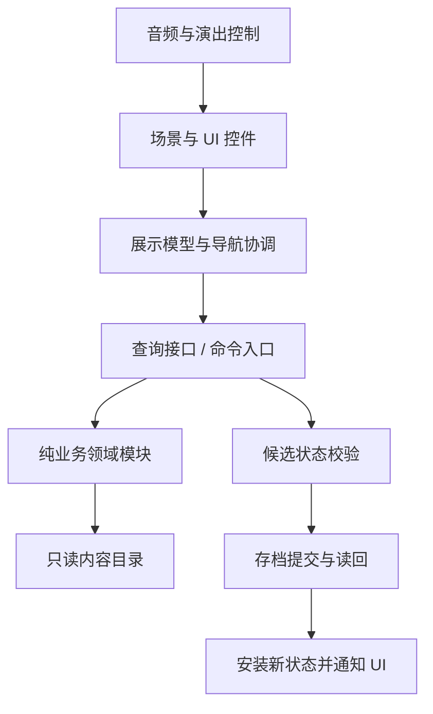

# 《寄往人间》Godot 完整迁移方案书 v1.0

编制日期：2026-10-19  
文档状态：方案评审稿；本轮只编写方案，不启动完整迁移。  
适用目标：独立、离线的 Android 与 Windows 版本。  
内容基线：`ordinary-release-v3`；核对时源码 HEAD 为 `159bd7e7e70500cbcbac09e35c1c7b728e3a1fe8`。  
阅读方式：先看第 1、3、10、14 节了解结论和交付，再按章节查技术细节。实施任务见[配套实施计划](../superpowers/plans/2026-10-19-godot-full-migration.md)。

---

## 1. 项目结论与目标

Godot 路线已通过小范围可行性验证，具备继续完整迁移的基础。用户反馈 Windows 和 Android 两端的“标题→主页→炼药工作台→示例选料→本地存档恢复”流程均通过；已有独立 EXE 和内置资源的 APK。

本次完整迁移的目标是：保留《寄往人间》已经确定的玩法、剧情、文风与美术，在 Godot 中建立可独立维护、离线运行、自主导出的正式版本。

这项工作包含重新接入界面与引擎接口、移植业务逻辑、转换内容、重建持久化和双端验收。它不是一键格式转换，也不把验证版的三词示例扩充后直接当成正式游戏。

### 1.1 交付目标

| 目标 | 完成条件 |
|---|---|
| Android | 可安装的签名 APK，全部正式资源内置，首次启动可断网，使用应用私有目录保存 |
| Windows | 可独立运行的 EXE/完整 ZIP，不依赖 Maker、Godot 编辑器、Python 或 Node |
| 内容完整 | 当前正式普通剧情、词条、炼药规则、订单、商店、日程和三个结局均可游玩 |
| 表现一致 | 保留现有美术主体、构图、纸面风格、字体和音频；逐页校正 Godot 版布局 |
| 状态可靠 | 保存失败不提前扣除资源，重复提交不重复发奖，重启可恢复阶段与已冻结结局 |
| 可维护 | 内容与程序分离，导出可复现，具备业务对照测试和真实设备验收记录 |

### 1.2 首轮不增加的内容

- 不新增剧情、配方、玩法或第四条结局，不借换引擎改数值平衡。
- 不把历史主线案件、五身份草案、开发者工具等未进入当前正式发行内容的功能一并实现。
- 不加入账号、云存档、广告、联网排行榜、远端热更新或新的统计 SDK。
- 不默认迁移 TapTap 宿主内的旧进度，不自动读取或覆盖 Maker 存档。
- 不在迁移尚未验收时删除旧工程、改绑应用或替换已发布版本。

---

## 2. 可行性验证：已经证明与仍需证明的部分

| 检查 | 当前证据 | 结论边界 |
|---|---|---|
| Godot 运行与资源导入 | 官方稳定版 4.7.2、导出模板 SHA512 校验；25 项美术/字体/音频副本 | 工具链已可用，不代表所有正式资源都已导入 |
| Windows 独立运行 | 内嵌资源 EXE，后台 smoke 检查退出码 0；用户提供实机截图并确认流程通过 | 完整玩法、持续运行和异机尚未全验 |
| Android 导出 | 66,706,223 字节 APK，arm64，v2/v3 签名、16 KiB 对齐与 ZIP CRC 检查通过 | 当前使用调试签名，不作为正式发布签名 |
| 本地资源与权限 | APK 有 Godot 引擎、脚本与资源，无权限声明，包含无 INTERNET 权限检查 | 用户未明确反馈“首次安装后飞行模式启动”，该项仍单列待验 |
| 示例业务与保存 | 选料、单次消耗、重复点击、重建实例恢复、坏档隔离检查通过；用户确认两端流程 | 只是简化示例，不覆盖正式发货事务与全量数据 |
| 布局 | 后台设计画布边界检查通过，但用户截图出现大物件与安卓黑边 | 数学上的画布不越界不能替代真实画面检查 |

### 2.1 已知表现问题

1. 网、商船、药炉显示尺寸过大，物件位置与原主页不一致，部分物件被画布裁切。
2. 安卓按固定 16:9 画布等比居中，宽屏出现黑色边带。
3. 工作台仍是验证布局，示例按钮、记录栏和正式版本不等价。
4. 验证版只接入一首 BGM，完整音乐场景切换、动作音效与音量持久化尚未迁移。

缩放问题优先检查 `TextureRect` 的纹理最小尺寸、expand_mode、size 设置顺序、父节点缩放及素材可见框。验证版 `picture()` 在设置 expand_mode 前设置 size 是明确的排查点，但本方案不将尚未实测的原因写成已经修复。

用户截图留档：[Windows](2026-10-19-godot-migration/win-spike-user.png)、[Android](2026-10-19-godot-migration/android-spike-user.jpg)。验证工程及原始结果见[验证版说明](../../experiments/godot-migration/README.md)。

---

## 3. 迁移范围与基准优先级

### 3.1 当前内容资产

以下为运行入口 `scripts/data/content.lua` 实际引用的数据，2026-10-19 只读核对：

| 数据 | 数量/标识 | 迁移要求 |
|---|---|---|
| 词条定义 | 77 | 保留 ID、文本、分类、效果和来源相关引用 |
| 原料 | 4 | 海盐、夜露、灰烬草、干花瓣；保留价格和实际药效修正 |
| 设备 | 2 | 保留槽位与容量约束，不改成验证版的单槽逻辑 |
| NPC | 11 | 保留人物 ID、名字、状态和后果关联 |
| 信件定义 | 22 | 包含普通来信与后续等定义，不等于 22 个独立正式订单 |
| 正式必做委托 | 11 | 以 release.requiredOrderIds 为清单 |
| 后果规则 | 196 | 逐条转换、比较条件、优先级、变化及互斥关系 |
| 回信片段 | 58 | 不改写正文，保留引用和组合规则 |
| 评分配置 | 58 | 保留判定阈值与分支映射 |
| 三结局 | departure / apprentice / wish | 离开、学徒、自己的愿望 |
| 内容版本/存档槽 | ordinary-release-v3 / ordinary_release_v3 | 用作旧系统对照基线，不复用为 Godot 生产存档目录 |

发行条件也随数据迁移：finalDay=14、minThreeStarOrders=8、每单报酬=100、船票价格=666、购票截止日=10。此处只是基线索引；具体是否可购买、何时收尾、如何确定分支，继续以现有协调器和测试结果为准，不能只抄这些数字重建一套简化规则。

### 3.2 发生冲突时按以下顺序判定

1. 用户已经确认的新要求及本轮新增决定。
2. 冻结基线中的实际正式代码、运行内容和经过核对的测试预期。
3. 最新前端接口手册、实际设备证据。
4. 历史设计稿和早期开发文档。

历史文档中的旧 schema、旧词条数量、案件流程和早期结局方案不能直接覆盖当前正式行为。迁移中发现旧版本自身存在问题时，单独记录“原有缺陷”与“迁移回归”，不悄悄改变预期。

### 3.3 功能迁移清单

| 模块 | 保留的功能 | 核心验收 |
|---|---|---|
| 标题与新旅程 | 开始、继续、结局留念、新旅程确认 | 继续按真实阶段恢复，新旅程保留留念 |
| 新手引导 | 开场便签、打捞/读信/剪词/接单、工作台四步、跳过、存档恢复、设置内重读便签 | 新旅程从 intro 到 complete/skip；重开恢复步骤；不重复读信、剪词或接单 |
| 主页 | 室内分层、物件热区、提示、返回 | 视觉位置与可点区域一致，弹窗期间不穿透 |
| 海边打捞 | 每日次数、瓶子、捕捞演出、收信 | 演出跳过/退出不重复收信，不重复扣次数 |
| 来信与裁词 | 抽屉、阅读、长信滚动、可剪词与反馈 | 来源 token 唯一，同名不同来源不合并；长文本不截断 |
| 词条托盘 | 分类、分页、选择、纸适应文字 | 长词条、低库存、已消耗状态均正确 |
| 炼药工作台 | 主辅词、原料、拖放/点击、配方提示、熬制、结果 | 正式规则可对照，试做和最终结算边界不混淆 |
| 订单与发货 | 接单、冻结基准、试做、待确认、确认、重置 | 只在事务提交成功后扣卡扣料、发奖、推进剧情 |
| 记录书 | 试做历史、配方、评分、来源、失败原因 | 历史展示不重算、不泄漏未触发正文 |
| 商队商店 | 原料、家居、船票、库存、价格报价 | 过期报价拒绝，购买只结算一次 |
| 日历与日程 | 每日限制、结束当天、补货、来信资格、收尾门禁 | 不凭 UI 自行增加一天或重置经营进度 |
| 三结局 | 离开演出、学徒信件、愿望拼贴与封瓶 | 结局文本和拼贴冻结，回顾不再次结算 |
| 回溯与留念 | 结局前检查点、回溯、新旅程、历史结局 | 回溯不损坏已冻结留念，确认动作可安全恢复 |
| 设置与声音 | BGM/音效开关和音量、场景切换 | 独立持久化，不叠播，首击资源已就绪 |
| 存档与恢复 | 首次开局、保存、旧版本识别、失败锁定与重读 | 所有中间状态均能恢复，无重复消耗或奖励 |

---

## 4. 推荐技术路线

### 4.1 选择：Godot 标准版 + GDScript + 内容转换

正式实现推荐使用 Godot 4.7.2 标准版、GDScript 和 Compatibility 渲染。先沿用已验证的版本，不在迁移中途追逐新版本；确需升级时单独验证。

业务逻辑按原有模块边界迁移到 GDScript；美术、音频和文本继续复用；内容由构建时导出工具从正式 Lua 数据转换为 JSON。正式包内不安装 Lua、不调用 Python，也不依赖 Maker 网络服务。

| 路线 | 优点 | 代价 | 决策 |
|---|---|---|---|
| GDScript 移植 + Lua 对照测试 | 引擎和导出链路简单、双端一致、长期维护清楚 | 业务逻辑需要逐项重写与验证 | 推荐主路线 |
| Godot 嵌入 Lua 扩展 | 可能保留部分纯 Lua 算法 | 增加原生扩展、ABI/版本/安卓编译依赖；UrhoX UI 仍需重建 | 首轮不采用 |
| 完整 Web 引擎离线封装 | 可能较多复用网页运行逻辑 | 资源分发、浏览器能力、隔离头和移动兼容仍需独立验证 | 保留研究记录，不与主路线并行开发 |

### 4.2 正式工程与验证工程分离

建议正式 Godot 项目位于仓库 `godot/`。当前 `experiments/godot-migration/` 保留为实验基线，不把其示例状态模块直接提升为正式订单系统。

```text
godot/
  project.godot
  export_presets.cfg
  scenes/
    boot.tscn / title.tscn / home.tscn / seaside.tscn
    brew.tscn / ending_departure.tscn / ending_apprentice.tscn
    ending_wish.tscn
  ui/components/
    paper_panel.tscn / word_slip.tscn / word_tray.tscn
    letter_reader.tscn / journal_book.tscn / modal_shell.tscn
  src/
    app/        # 入口、场景协调、导航与输入锁
    domain/     # 纯业务计算、规则、订单、日程、结局
    content/    # JSON 加载、结构与引用校验
    persistence/# 快照、提交记录、恢复、设置
    audio/      # BGM、音效、音量和生命周期
    presentation/# 展示模型、演出、视图绑定
  content/generated/  # 由 Lua 内容导出的只读 JSON
  media/              # 正式资源快照及许可说明
  tools/              # 内容导出、资源准备、验证与构建入口
  tests/
    unit/ / parity/ / integration/ / fixtures/
  docs/               # 操作和版本说明
  build/              # 本机产物，不入普通源码提交
```

资源不通过跨工程符号链接在运行时读取。准备阶段按正式引用清单复制到 `godot/media/`，记录原路径、哈希与用途；避免把素材源文件、编辑器数据库、测试录像和旧候选图一起装进 APK。

### 4.3 层次与依赖



- UI 读取查询投影、提交操作请求，不直接修改库存、金币、天数或存档。
- 业务模块不引用场景节点、TextureRect、按钮或声音播放器。
- 场景动画不是订单提交的依据。跳过动画、切场景或退出时，结果仍由已提交状态决定。
- 自定义信号用于呈现刷新；不在多个信号监听者中重复执行结算。

---

## 5. 内容与业务逻辑迁移

### 5.1 内容转换流水线

`正式 Lua 数据 → 隔离导出工具 → JSON + 内容目录/哈希 → Godot 校验 → 业务读取`

1. 从 `scripts/data/content.lua` 加载实际运行配置，沿用已有隔离测试环境；不靠正则解析 Lua 源码。
2. 数组与字典使用明确字段类型；Lua 的空表在导出时按内容 schema 决定是 `[]` 还是 `{}`。
3. ID 全部保留为字符串；计数、天数、revision 保持整数语义；药效计算明确浮点规则。
4. 保留正文换行、中文符号、强调和可剪跨度；不自动改文风或重新裁定词条。
5. 导出后检查数量、重复 ID、悬空引用、缺少片段、条件类型和枚举范围；失败则阻止构建。
6. `content/generated/` 不手工编辑。迁移期内容继续在原权威表维护，导出工具负责同步；正式切换内容编辑方式须另立一次明确迁移。

### 5.2 业务模块映射

| 旧模块 | Godot 目标职责 |
|---|---|
| GameSession / GameState / PlayQueries / ReleaseCoordinator | SessionService、CommandRouter、QueryService、状态安装与锁定 |
| GameFlow / ReleaseLedger | DayFlow、日程资格、次数和发行进度 |
| Letter / WordToken / RecipeDraft | 信件实例、来源 token、可剪跨度、草稿槽位 |
| Potion / StoryRules / CalculationGuard | 纯配方计算、效果判定、输入边界与错误 |
| Order / OrderTrial / OrderLifecycle / OrderAudit | 接单、试做、待确认、确认、幂等和对账 |
| Economy / WorldState / Narrative | 库存与购买、人物事实、后果规则、回信与评分 |
| BrewJournal / JourneyRecord / RewindHistory | 试做历史、旅程记录和检查点 |
| ReleaseEndings / ReleaseEpilogue / WishCollage | 收尾状态、演出步骤、结局与拼贴冻结 |
| SaveSystem / SaveSchema / SaveMigrations | 本地快照、版本、读回验证、提交结果不确定时的恢复 |

历史开发模块和未接入正式路线的功能不因为出现在目录里就自动迁移。正式范围按第 3 节清单验收。

### 5.3 一致性验证：旧 Lua 作为对照

迁移不是重新猜测规则。为每一类业务冻结输入和输出，分别在 Lua 与 Godot 执行，比较：

- 计算结果：主辅词组合、原料修正、阈值边界、非法输入和错误码。
- 状态结果：库存、金币、来源 token、订单阶段、人物事实、日程和 revision。
- 叙事结果：触发的规则、片段 ID、回信原文、评分、结局 kind 与冻结正文。
- 操作结果：同一事务重放、重复按钮、过期报价、保存失败和恢复后的事件数量。

有序内容按顺序比较；无序映射先规范键顺序再比较；数字误差不能采用全局宽容阈值掩盖逻辑不同。先按原算法复现，确需浮点容差时逐字段定义，并补阈值两侧用例。

### 5.4 统一请求边界

建议统一命令请求：`{request_id, expected_revision, command, payload}`。

返回：成功为 `{ok:true, revision, value}`；失败为 `{ok:false, error:{code,path,message}}`。领域查询返回深复制投影，避免 Godot Dictionary 的引用语义让 UI 绕过命令入口改状态。

同一 request_id 已提交时返回已有结果；expected_revision 过期时拒绝操作并刷新视图。错误提示面向玩家，不把堆栈或技术字段显示在正式界面。

---

## 6. 画面、布局与交互迁移

### 6.1 视觉目标

保留温暖木质药铺、雾蓝海港、手写信纸、铜锅与拼贴纸条的既有风格。标题、主页、海边、工作台和三个结局分别设基准截图；同屏幕尺寸比较主物件位置、比例、层级、透明边缘、文字和热区。

不把“同一张 PNG 能显示”视为该页面完成，也不以自动截图相似度取代人眼确认。程序先达到可测、可对照，再逐页做表现验收。

### 6.2 坐标与缩放策略

- 以 1920×1080 为场景设计基准，保留 LayoutManifest 等既有中心坐标、尺寸、旋转与层级含义。
- 物件尺寸根据实际 PNG 尺寸与元数据可见框计算；透明留白不能当成主体宽高。
- 图片控件先配置纹理最小尺寸/expand 行为，再应用目标尺寸；父缩放与物件缩放只各承担一个明确职责。
- 背景、场景物件、HUD 和弹层分层。背景可覆盖宽屏；文字与按钮位于安全区域；不能把整页 UI 横向拉伸来消除黑边。
- 背景在 16:9、19.5:9、20:9 和接近用户截图的 2412×1080 比例下分别检查。优先使用原背景和边缘扩展画面覆盖多余区域；需要裁切时只裁安全装饰，保留门口、药炉和关键物件。
- 工作台使用锚点与 Container 管理左右侧栏；空间不足时侧栏收为可打开的抽屉，中央锅与主要操作保持可见。
- 窗口调整大小、横屏刘海、系统导航区和切后台回来后都重新计算；竖持时给出横屏提示，不把极小的横屏画布当作正式竖屏玩法。

### 6.3 主页与海边

主页恢复室内前景、海面、商船和独立物件的正确投影。优先修复本轮截图里的大网、大船、大锅，再校准提示标签和按钮位置。热区绑定物件可见主体，允许适度扩展触控范围，不把影子或透明留白全部当按钮。

海边保留海面、码头、商船、漂流瓶、涟漪与捕捞反馈。动画状态与业务阶段分开保存；退出后恢复收取结果，而非从一段未提交动画重新发奖。

### 6.4 阅读与长词条

- 信件显示原文，使用明确的跨度/标记数据渲染可剪词，不通过全局文本替换识别同名词。
- 纸条宽度由测量后的文字、左右内边距、最小宽度和可用最大宽度决定。
- 超出最大宽度后按确定规则换行，纸条高度随行数增长；不要只缩小字体使长词不可读。
- 托盘、拖拽预览、配方槽和拼贴统一使用 WordSlip 组件，避免四处各写一套纸条规则。
- 文字测量必须设置真实字体和字号；中文、标点、长词、两行词条、选中边框和触控热区一并验收。

### 6.5 拖放与触屏

支持点击选择与拖放两条路径。拖动开始阈值、滚动优先级、取消、释放在目标外、切后台、打开弹层和换页均有明确处理。

只有模型接受投料后才呈现成功动画。拖拽预览不改变库存，不从移动距离推断一次结算；多点触控不让第二根手指接管已有操作。安卓返回键、Windows Escape 按统一规则依次取消拖动、关闭顶层弹窗或询问退出。

### 6.6 三结局呈现

| 结局 | 迁移目标 | 状态要求 |
|---|---|---|
| 离开 departure | 船票、离开药铺、海边乘船等现有演出 | 先保存购票与结局，再播放演出；重启不再次扣款 |
| 学徒 apprentice | 商人捎信的旁白、信件展开、正文与后续收束 | 保存演出步骤；继续和跳过均到达同一已冻结结果 |
| 自己的愿望 wish | 室内桌面、左侧词条托盘、纸面拼贴、预览与封瓶 | 来源 token、归一化位置、旋转、层级和装饰可恢复；回顾使用冻结拼贴 |

结局资格由既有规则决定，UI 不新增“选哪个结局”的按钮或暴露资格统计。当前版本的回溯、留念与新旅程行为也作为正式迁移范围。

---

## 7. 存档、版本与事务

### 7.1 独立存档边界

正式 Godot 版使用独立的 user:// 目录和包名；验证版仍使用自己的测试目录。Windows 存档放在用户应用数据目录，不能存放在安装目录或可能被更新覆盖的资源包内。

建议新封装字段：`format=tthw-godot`、`schema_version=1`、`content_version`、`revision`、`generation`、`checksum`、`payload`。这里的 schema_version 是 Godot 文件封装版本，不假冒旧 Lua schema 4；payload 的逻辑契约与迁移映射单独定义。

TapTap 版历史进度不能自动跨应用出现。旧档导入作为后续可选工具：用户主动提供导出文件，先校验来源版本，在新槽副本中转换，原文件保持不变。首轮交付不把旧档导入列为阻断项。

### 7.2 正式命令的提交顺序

`验证请求 → 深复制候选 → 计算结果 → 审计候选 → 写非活动快照 → 读回校验 → 提交标记并确认 → 安装内存状态 → 通知表现层`

- 延续 A/B 快照与提交代数思想，不把“覆盖一个 JSON 文件”当成正式存档方案。
- 写入或校验明确失败时，不安装候选、不提前扣卡扣料、不发奖。
- 提交标记可能已落盘、但读回失败时，进入“结果不确定”锁定状态，允许重读同槽判定；不能盲目回滚内存后让玩家再提交一次。
- 重启选取最高有效已提交代，不能只依赖修改时间；坏档、内容版本不兼容与更新迁移分别提示。
- 保留事务 ID、已提交记录、冻结结果与 revision，确保发货、购票、家居购买和结局确认幂等。
- 不能承诺抵抗所有物理磁盘故障；方案通过双份、校验和恢复降低损坏风险，并对写盘异常进行注入测试。

### 7.3 必须覆盖的重启点

未读信、已裁未投料、已接单草稿、试做完成待确认、确认已提交、结局演出中、拼贴编辑中、封瓶后、回溯后、新旅程后。每项均验证库存、金币、剧情阶段、历史记录和恢复后的可操作性。

音量等设置采用独立小配置，不因重开旅程重置。窗口位置和临时拖拽姿态不进入正式业务快照。

---

## 8. 离线资源、音频与性能

### 8.1 真正离线的定义

1. 所有正式场景、字体、图片、音频、数据与运行库随包提供。
2. 首次安装后、从未联网的情况下可以进入游戏并完成核心流程。
3. 资源加载只访问 res:// 或 user://，不依赖 CDN、Maker 预览地址、宿主登录和在线 token。
4. Android APK 无 INTERNET 权限；Windows 版通过离线环境验证，不把“没有主动点联网按钮”当证据。
5. 不把本机缓存已存在后的断网通过，误认为首次冷启动离线通过。

### 8.2 加载页

沿用海港加载画面与真实进度思路，但改为本地资源加载状态。先显示轻量背景与字体，再按标题/主页、海边、炼药、结局分组读取。

加载完成门禁包含资源成功、目标页面装配、布局完成和目标首帧；加载失败提供可点击的重试。离线版不再保留“网络慢”提示，也不显示虚假的下载进度。

图片只在需要时持有，切场景释放可重建引用；不要为了“预热”一口气常驻全部高分辨率图。透明图用可见框与导入设置管理内存，不能把 PNG 文件体积当实际显存消耗。

### 8.3 声音

以 AudioCatalog 的实际引用建立 Godot 音频目录，分别管理 BGM 与 SFX 总线。音乐切换支持淡入淡出且只有受控的活动播放器；首击音效在进入可交互页面前就绪。

保留静音、独立音量、结局临时淡出、切后台与恢复策略。验证听感时必须用真实设备，后台脚本调用成功不代表用户听见声音。

### 8.4 建议性能目标

以下为评审目标，不是现有实测承诺。P1 记录用户手机型号、Android 版本、分辨率和内存，P2 形成基线后决定是否需要调整目标。

| 项目 | 初始验收目标 |
|---|---|
| Android 正常游玩 | 持续达到 30 FPS，关键交互无持续卡顿 |
| Windows 正常游玩 | 常用电脑目标 60 FPS |
| 点击/选料反馈 | 通常在 100 ms 内出现可见反馈 |
| 本地首次进入可操作页面 | 参考目标 8 秒以内，按测试机多次记录 |
| 资源内存 | 记录各场景峰值与退出后的回落，不在常驻内存中加载全素材库 |
| 稳定性 | 连续一小时及多次后台切换、保存恢复，无阻断性崩溃或状态损坏 |

---

## 9. Android 与 Windows 工程及发行

### 9.1 工具版本

优先固定已经导出成功的 Godot 4.7.2 标准版及同版本模板。首轮不接原生扩展，复用本机 Java 21 与 Android SDK；当前测试包 minSdk 24、targetSdk 36、arm64。

最低 API 声明不是全部低端设备的兼容承诺。正式设备范围要结合 OpenGL ES 能力、纹理内存和实测结果确认；Windows 首发先验收 x64。不同设备架构新增为单独构建目标。

### 9.2 测试包与正式包

- 验证、候选、正式包使用明确版本与构建标记；测试包名与正式应用隔离。
- 正式包名在首次发布前确定并冻结；不能在后续更新中随意改变签名和包名。
- 调试签名只用于测试。正式签名由用户持有和备份，密钥与密码不提交仓库、不写入公开构建日志。
- APK 交付时提供版本、包名、权限清单、架构、SHA256、签名证书摘要和已知限制。
- Windows ZIP 内包括可执行文件、所需资源、第三方许可及简明运行说明；玩家存档不打进发布包。
- 使用设备/平台适用的提交规则；“已导出可安装”不自动等于商店或比赛审核通过。

### 9.3 可复现构建

约定一个构建入口完成：校验源基线→导出内容→检查资源及许可→运行自动测试→Godot 导入→导出平台包→签名与结构验证→生成 delivery.json。

构建清单记录源码 revision、内容版本、Godot/模板版本、资源哈希、包体哈希、架构与检查结果。禁止源码已更新但继续交付旧 APK，却只修改文件名或版本说明。

---

## 10. 阶段实施与放行条件

| 阶段 | 主要工作 | 阶段交付 | 放行条件 |
|---|---|---|---|
| P0：视觉基线与正式骨架 | 修正物件缩放/定位；宽屏/安全区；正式目录、公共纸条组件、资源清单 | 正确构图的标题/主页/工作台、同版双端包 | 用户确认 Win/APK 物件比例；关键热区可点；宽屏不出现生硬黑带或裁掉主物件 |
| P1：内容与业务基础 | 数据导出、校验、查询命令边界；正式本地存档；领域对照夹具 | 完整内容目录、存档与一致性报告 | 引用校验通过；保存故障不提前结算；基础计算与 Lua 一致 |
| P2：完整首单闭环 | 打捞、收信、裁词、托盘、接单、试做、确认发货、记录书 | 一单真实内容可完整离线游玩 | 首单成功/失败/重置/重复点击/重启均通过；双端可完成 |
| P3：全部经营内容 | 其余正式订单、规则后果、回信评分、日历、补货、商店、家居与船票 | 11 单与经营流程候选版 | 全量对照无未解释差异；日程、报价和库存正确；长信/长词可用 |
| P4：三个结局与回顾 | 学徒信件、离开演出、愿望拼贴、封瓶、留念、回溯和新旅程 | 三结局完整可玩版 | 各路线可达；步骤可恢复；封瓶/购票/回顾无重复结算 |
| P5：表现与设备优化 | 完整音频、加载页、动效、输入生命周期、性能与设备适配 | 双端发布候选包 | 飞行模式首次启动、触控、存档、听感和连续运行验收通过 |
| P6：发行交付与切换 | 正式签名、干净包、版本清单、文档和回滚档案 | APK、Windows ZIP、源码与验收报告 | 用户确认发布候选；无阻断项；最后才执行平台上传或替换 |

P0 的视觉修正不能被“后台测试通过”跳过。P2 的首单不能使用验证版的三词示例冒充正式订单。P4 不允许为了赶进度用静态结局图替代拼贴、步骤恢复与留念。

### 10.1 工作量与排期口径

当前只确认了小样可行，尚无完整迁移速度数据，因此不承诺固定完成日期。先完成 P0、P1、P2，并记录实际耗时、移植模块数量、差异和返工原因，再给 P3～P6 的排期。

安排优先级为：正确性与存档可靠性→可完整游玩→布局与操作→演出与音频完善→优化与发行。存在外部比赛截止时间时，先核对真实日期和允许提交形式，再评估范围；不能通过省略验收宣称完整迁移完成。

---

## 11. 验收矩阵

| 编号 | 验收场景 | 通过标准 | 证据 |
|---|---|---|---|
| A01 | 全新安装、飞行模式启动 | 不依赖缓存/网络/登录，进入标题并可游玩 | 安卓设备、版本、录屏和日志 |
| A02 | Windows 干净目录启动 | 不安装开发工具也能运行，资源齐全 | 解压目录、构建号、进程日志 |
| A03 | 主页/海边/工作台布局 | 同分辨率主物件比例和热区正确 | 双端基准截图和人工确认 |
| A04 | 不同比例/刘海/窗口缩放 | 文字和按钮不被系统区遮挡，主内容不被裁掉 | 16:9、19.5:9、20:9 与用户设备截图 |
| A05 | 长信、长词、纸条拖拽 | 原文完整，纸条适配文字，点击与拖动不串操作 | 代表性长文本夹具与设备记录 |
| A06 | 同名来源词、重复裁剪 | 按来源 ID 跟踪，不能重复获取或错误消耗 | 状态快照与重放测试 |
| A07 | 药效与评分 | 全量夹具与旧 Lua 结果一致 | 机器可读差异报告，差异必须归零或被明确裁定 |
| A08 | 试做、发货、重置 | 与正式事务边界一致，无提前扣除、重复奖励 | 前后快照、库存/金币/记录审计 |
| A09 | 商店与日程 | 过期报价、低库存、补货、每日捕捞和结束当天正确 | 自动测试与双端操作 |
| A10 | 保存明确失败/结果不确定 | 保留数据、不误报成功、不允许二次结算；同槽重读可恢复 | 故障注入、提交标记和日志 |
| A11 | 各中间阶段重启 | 恢复真实阶段、草稿、待确认、结局步骤和拼贴 | 新进程/真实应用重启验证 |
| A12 | 三结局完整演出 | 正文与路线正确，可继续/跳过/重启，回顾不结算 | 三路线存档与录屏 |
| A13 | 回溯、新旅程、留念 | 只改变应改变的进度，历史冻结结果保留 | 回溯前后及重启快照 |
| A14 | 声音与设置 | 不叠播、静音持久、首击及时、后台恢复正常 | 双端真人听感 |
| A15 | 稳定性与性能 | 达到约定设备目标，无持续卡顿或状态损坏 | 帧时间/内存记录、连续运行和后台切换 |
| A16 | 发行包与更新 | 权限符合离线目标、签名和版本正确、干净包无私人文件 | APK/ZIP 检查、SHA256、安装更新验证 |

自动检查、桌面原生运行、安卓实机、人工画面和听感分别记录。任一类缺少证据就标“未验”，不使用另一类通过替代。

---

## 12. 主要风险与处理

| 风险 | 影响 | 处理方式 |
|---|---|---|
| Lua → GDScript 数值/容器语义变化 | 药效、评分、空表、ID 或排序变化 | 明确类型、复制和排序；逐模块对照，不靠肉眼猜 |
| 简化示例混入正式系统 | 试做提前消耗、订单/结局条件被改写 | 实验工程保留，正式项目单独建立，P2 使用真实内容 |
| 素材最小尺寸/可见框错误 | 大物件、错位、点击区域错误 | P0 固定每层目标框与真实运行尺寸，截图验收 |
| 仅按 16:9 缩放 | 宽屏黑边或内容过小 | 背景与安全区分层，侧栏响应式和真机确认 |
| 迁移过程中旧版继续变化 | Godot 内容与旧版漂移 | 冻结版本与哈希；后续改动以清单同步和重新导出 |
| 单文件保存/误判提交失败 | 丢档、重复扣款或发奖 | 正式 A/B 提交与结果不确定状态，故障注入和重启审计 |
| 图片和声音一次性常驻 | 安卓内存过高、首帧慢 | 分组加载、资源生命周期和设备峰值测量 |
| 主线历史资料混入普通首发 | 范围和剧情变化 | 当前正式入口与 requiredOrderIds 定义范围，扩展另立任务 |
| 只测一台设备 | 低端机/宽屏或系统版本问题未发现 | 用户手机必测；增加另一种比例或较低性能安卓设备 |
| 签名与版本管理失误 | 更新失败或包体无法追溯 | 用户保管正式签名，构建清单和固定版本规则 |

---

## 13. 协作方式与决策

### 13.1 程序执行侧负责

工程搭建、素材与内容转换、模块移植、对照测试、布局修正、离线打包、证据和已知限制记录。日常默认后台检查，不控制用户的桌面、鼠标或手机；不因文档写完就自动进入全量迁移或上传。

### 13.2 用户负责的最小配合

- 评审本方案的目标、首轮范围和阶段顺序。
- P0 提供主要测试手机的型号、Android 版本，并确认双端构图。
- P2、P4、P5 分阶段测试实际体验；反馈包版本与明确复现步骤。
- 发布前确定正式包名、图标/标题，并自行保管正式签名的安全备份。

不要求用户先研究 Godot 编译或安装整套开发环境；当前便携版与导出工具已可用。需要用户决定的内容集中到阶段检查点，不反复询问已确认的常规实现细节。

### 13.3 发生范围变化时

新增主线、重写剧情、修改配方平衡、云同步或新平台，都单独标记为新增需求，评估对排期和验收的影响。不得把迁移中出现的实现便利当作改变设计的授权。

---

## 14. 最终交付与“完成”的定义

完整交付包括：

1. 可编辑 Godot 正式工程、内容导出工具、资源来源清单及许可。
2. 全部正式普通经营内容、11 单流程与三个结局；源代码与原规则对照结果。
3. Android 正式签名 APK 和 Windows 干净 ZIP，版本、架构、哈希和运行说明。
4. 完整存档方案、错误恢复说明、更新与可选旧档导入边界。
5. 自动测试、双端人工验收、真实安卓离线与听感报告。
6. 冻结的 Maker 对照版本与 Godot 上一可运行包，支持在切换前回退。

完成标准：第 11 节适用验收项均有明确证据，未通过项全部列出并经用户决定是否接受；不能把“导出 APK 成功”称为完整迁移完成。正式替换和发布是最后一个独立步骤。

本方案评审通过后的第一批工作只进入 P0：正式骨架、正确物件比例、宽屏适配和双端视觉基准。完成并确认后再推进正式业务。

---

## 15. 依据与自检

### 项目依据

- [现有验证版](../../experiments/godot-migration/README.md)
- [游戏内容入口](../../scripts/data/content.lua)、[发行配置](../../scripts/data/release.lua)、[三结局正文](../../scripts/data/release_endings.lua)
- [前端接口手册](../../scripts/前端接入接口手册.md)，优先阅读顶部最新契约
- [会话装配](../../scripts/core/GameSession.lua)、[状态协调](../../scripts/core/GameState.lua)、[存档](../../scripts/core/SaveSystem.lua)
- [愿望拼贴](../../scripts/systems/WishCollage.lua)、[结局规则](../../scripts/systems/ReleaseEndings.lua)
- 用户在本会话确认的 Windows 与 Android 小样流程及两张截图；该确认不包含未明确报告的飞行模式首次启动或完整游戏验收。

### Godot 官方资料

- [UI 尺寸与锚点](https://docs.godotengine.org/en/stable/tutorials/ui/size_and_anchors.html)
- [本地保存](https://docs.godotengine.org/en/stable/tutorials/io/saving_games.html)，本文在基础 API 上另行设计事务与恢复，不把官方示例当完整可靠存档方案
- [Android 导出](https://docs.godotengine.org/en/stable/tutorials/export/exporting_for_android.html)
- [Windows 导出](https://docs.godotengine.org/en/stable/tutorials/export/exporting_for_windows.html)

### 文档自检结论

范围覆盖当前普通剧情与三个结局；已区分可行性小样和正式系统、用户实测和后台证据、离线包和平台审核。未许诺未经测量的固定工期、像素一致或全设备兼容。阶段间均设置明确放行条件，旧工程和生产进度保持独立。
